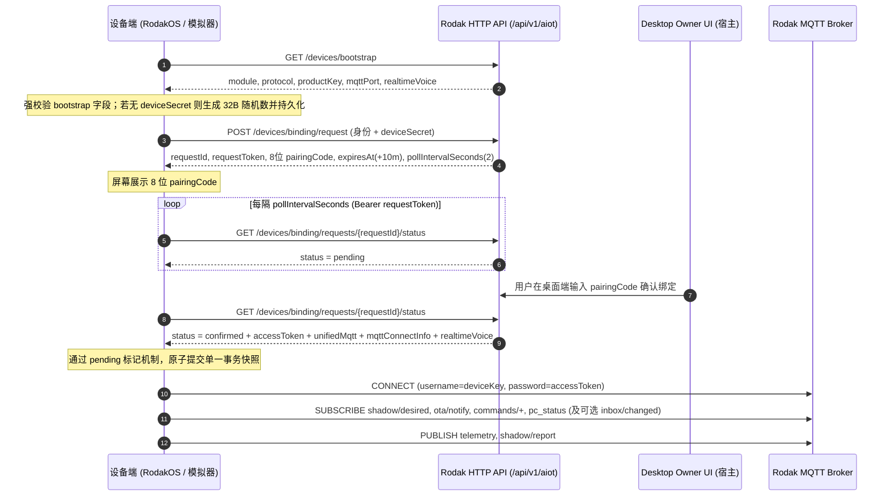
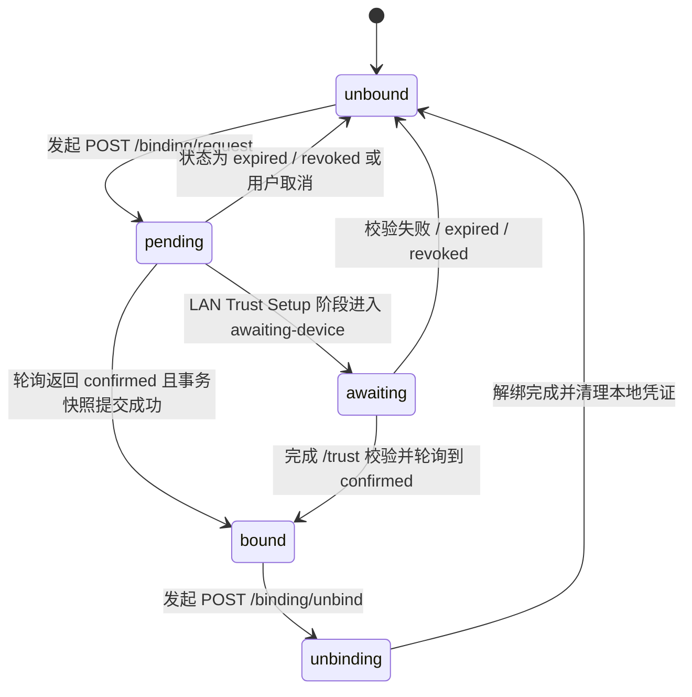

# 设备入网、宿主绑定、鉴权与安全模式实战

> **参考规范**：本文依据 [rodak-aiot-contract-v1.md](https://github.com/rymcu/rodakos/blob/main/docs/rodak-aiot-contract-v1.md)（§2–§6）整理，重点拆解 `DeviceCloudConfigService`（设备端）与 `/api/v1/aiot`（服务端）在入网、绑定、Token 刷新与安全持久化方面的实现契约。

## 1. 完整入网与绑定 9 步流程

一台新设备（或已解绑设备）接入 Rodak 服务端，必须严格按以下 9 步推进：



### 关键步骤实现要点

1. **引导强校验（步骤 1）**：收到 `/bootstrap` 后必须核对 `module == "aiot"`、`protocol == "rodak-aiot"`、`productKey == "rymcu-bigsmart"`、`protocolVersion == 1`，任意不匹配即终止流程。
2. **密钥本地生成（步骤 2）**：若本地尚无 `deviceSecret`，使用密码学安全随机源生成 32 字节随机数并转为 64 位小写十六进制字符串后持久化。
3. **配对码展示与轮询（步骤 3–6）**：`pairingCode` 为 8 位码，有效期 `+10 分钟`，默认轮询间隔 `pollIntervalSeconds = 2`。轮询时在请求头携带 `Authorization: Bearer <requestToken>`。
4. **原子快照落盘（步骤 8）**：轮询得到 `status=confirmed` 后，必须将 AIoT 身份、`accessToken`、`unifiedMqtt`、`realtimeVoice` 作为**单个事务快照**写入持久存储，避免断电导致“有 Token 却无 MQTT 配置”的半写入状态。
5. **已绑定设备跳过绑定**：若设备已经完成绑定，仅是 `accessToken` 过期，则**跳过步骤 3–9**，直接调用 `POST /api/v1/aiot/devices/auth/token` 刷新凭证。

## 2. 绑定状态机设计

协议 §5 定义了清晰的状态转换模型，建议设备端与模拟器严格按状态机驱动 UI 与网络重试：



状态接口 `GET /binding/requests/{requestId}/status` 可能返回的 5 种业务状态：`pending`、`awaiting-device`、`confirmed`、`expired`、`revoked`。

## 3. HTTP API 契约与限流规则

所有端点均挂载在配置的服务端 Origin 下，完整的请求/响应 Schema 见仓库中的 `contracts/rodak-aiot/v1/openapi.yaml`：

| 端点路径 | 鉴权方式 | 核心说明与约束 |
| :--- | :--- | :--- |
| `GET /api/v1/aiot/devices/bootstrap` | 无鉴权 | 获取引导信息与协议版本元数据。 |
| `POST /api/v1/aiot/devices/binding/request` | 无鉴权 | 发起绑定请求。**服务端限流**：全局最多 256 个未过期请求、单设备最多 3 个 `pending`、每 60 秒最多 20 次请求。 |
| `GET /api/v1/aiot/devices/binding/requests/{requestId}/status` | `Bearer requestToken` | 轮询绑定状态；`confirmed` 时返回完整 Token 与连接描述符。 |
| `POST /api/v1/aiot/devices/binding/requests/{requestId}/trust` | `Bearer requestToken` | **仅 HTTPS 可用**，用于 LAN Trust Setup 提交 SRP 证明。 |
| `POST /api/v1/aiot/devices/auth/token` | 无鉴权（请求体带密钥） | 已绑定设备刷新 `accessToken`。 |
| `POST /api/v1/aiot/devices/binding/unbind` | `Bearer accessToken` | 解除绑定，请求体必须为 `{}`。 |
| `GET /api/v1/aiot/devices/inbox` | `Bearer accessToken` | **草案（§7.6）**：拉取消息中心有界快照（家庭共享通知与待办提醒，最新在前），走 Pin 模式固定 HTTPS 源站。 |
| `POST /api/v1/aiot/devices/inbox/actions` | `Bearer accessToken` | **草案（§7.6）**：提交已读（`read`）、待办完成（`complete`）或提醒推迟（`snooze`）动作，携带 `opId` 与 `expectedRevision` 保证幂等。 |

> **禁止使用的端点**：服务端虽保留了心跳、遥测、影子、命令拉取等 HTTP fallback 接口，但 RodakOS 并不使用；`POST /devices/register` 与 `/devices/activate` 属于历史迁移端点，**设备端严禁调用**。

## 4. 必避深坑：HTTP 状态码与统一响应信封

这是新手对接 HTTP API 时最容易写出 Bug 的地方（协议 §4.1）：

服务端所有业务接口均采用统一 JSON 信封格式：

```json
{
  "code": 200,
  "message": "...",
  "data": {}
}
```

**核心解析规则（必须按两步检查）**：

1. **先检查 HTTP 状态码**：只有当 `accessToken` 预检失败时，服务端才会返回 **HTTP 401**（此时应触发 Token 刷新逻辑）；除此之外，绝大多数业务错误（信封内 `code` 为 `400`–`503`，例如消息中心用同一 `opId` 提交不同请求体时 Rodak 返回业务码 `409`）返回的 **HTTP 状态码仍然是 200**，且 `data` 为 `null`（仅 `/api/v1/aiot/appearance/` 外观资源路由除外）。
2. **再检查信封 `code` 字段**：只有 `HTTP 200` **且** `code == 200` 才代表业务成功；切勿仅凭 HTTP 200 就直接解析 `data` 字段，否则会引发空指针或错误的状态跳转。

## 5. LAN Trust Setup（无 USB 局域网建信）

在没有 USB 线缆烧录证书的场景下，设备可通过局域网建信进入 Pin 模式：

1. 设备在 HTTPS 监听条件下调用 `POST /binding/request`，并在请求中携带 `trustSetup` 参数（用 SRP 密钥交换替代 8 位配对码）。
2. 轮询状态从 `pending` 流转到 `awaiting-device`。
3. 设备向 `POST /api/v1/aiot/devices/binding/requests/{requestId}/trust`（携带 `Bearer requestToken`）提交 SRP 证明。
4. 服务端校验通过后，返回**密封（sealed）的服务端信任锚点**以及**一次性替换后的新 `requestToken`**。
5. 设备使用新 `requestToken` 继续轮询直至 `confirmed`，并切换至 Pin 模式。

## 6. 凭证安全、事务持久化与两种模式对比

### 6.1 事务性持久化与日志脱敏（§6.1）

* **先写 Pending 标记，失败即回滚**：AIoT 身份、`accessToken`、`realtimeVoice` 描述符与 `unifiedMqtt` 配置必须作为同一原子快照提交。写入前先落盘 pending 标记，只有全部写入校验通过后才清除标记；若中途失败或重启，自动回滚至上一份完整快照。
* **零泄露原则**：`deviceSecret`、`requestToken`、`accessToken` 等任何密钥材料**严禁**打印到日志、串口终端，也**严禁**写入设备 Shadow。

### 6.2 Legacy mode 与 Pin mode 行为差异（§4.4 & §6.2）

| 对比维度 | Legacy mode | Pin mode |
| :--- | :--- | :--- |
| **信任锚点与域名** | 无服务端信任锚点 | 已安装服务端信任锚点，绑定固定 TLS 域名 `rodak-<16 hex>.local` |
| **HTTP / MQTT 传输** | 允许明文 HTTP / MQTT | 强制加密（HTTPS / `mqtts`） |
| **实时语音传输** | 允许 `ws://` | 强制 `wss://` |
| **TLS 安全策略** | 无严格 Pin 限制 | 禁止不安全重定向与回退到公共 CA；OTA 与 Appearance 资源下载均受校验约束 |
| **Token 刷新返回 403/404** | 清空本地 Token 与 MQTT 配置，自动退回绑定流程 | 保留设备身份、上报 `credentials rejected`，**不自动重新发起配对** |

---

**下一篇推荐**：阅读《统一 MQTT、指令系统、设备影子与实时语音交接指南》，掌握长连接 Topic 规范、指令回执、WebRTC 互斥推流以及实时语音参数交接。
