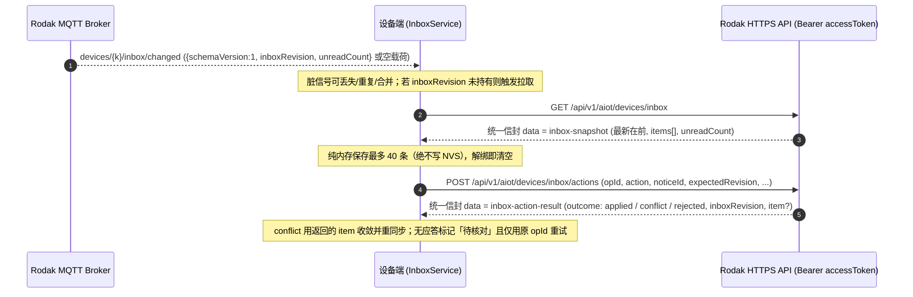

# 统一 MQTT、指令系统、设备影子与实时语音交接指南

> **参考规范**：本文依据 [rodak-aiot-contract-v1.md](https://github.com/rymcu/rodakos/blob/main/docs/rodak-aiot-contract-v1.md)（§7–§11）整理，帮助开发者实现 `UnifiedMqttService`（UMS）、设备指令处理、影子同步以及 `RodakRealtimeVoiceTransport` 的交接逻辑。

## 1. Unified MQTT 连接配置与 Topic 全景

绑定确认或刷新 Token 后，服务端返回的 `unifiedMqtt` 描述符给出了完整的 MQTT 连接与路由信息（对应的 AsyncAPI 定义位于 `contracts/rodak-aiot/v1/asyncapi.yaml`）：

* **核心连接字段**：`protocol_version: 2`、`broker_address`、`broker_port`、`username`（即 `deviceKey`）、`password`（即 `accessToken`）、`keepalive: 240`、`device_key`、`http_base_url`、`http_bearer_token`、`home_enabled: 0` 以及完整的 `topics` 映射（其中 `topics.inbox_changed` 为**可选**草案字段，仅当 Broker ACL 允许该订阅时由服务端下发）。
* **传输层安全**：Legacy 模式允许明文 MQTT；Pin 模式强制使用 `mqtts` 并校验服务端信任锚点与固定域名。

### Topic 订阅与发布清单

以下 `{k}` 代表设备的 `deviceKey`。全链路默认以 **QoS 0** 为主，唯一特例是 `ota/progress` 上报 `staged` 状态时 RodakOS 使用 **QoS 1** 确保送达。

| 方向 | Topic 路径 | 默认 QoS | 核心用途 |
| :--- | :--- | :--- | :--- |
| **设备订阅（下行）** | `devices/{k}/shadow/desired` | 0 | 接收服务端下发的期望影子状态（如音量、唤醒配置等）。 |
| **设备订阅（下行）** | `devices/{k}/ota/notify` | 0 | 接收 OTA 升级通知，触发检查与下载流程。 |
| **设备订阅（下行）** | `devices/{k}/commands/+` | 0 | 订阅 `devices/{k}/commands/{commandNo}` 接收单次指令。 |
| **设备订阅（下行）** | `devices/{k}/pc_status` | 0 | 接收宿主 PC 状态同步消息。 |
| **设备订阅（下行，可选草案）** | `devices/{k}/inbox/changed` | 0 | 接收消息中心无正文变更脏信号（§7.6）；**仅当 `unifiedMqtt.topics.inbox_changed` 存在且精确匹配 `devices/{k}/inbox/changed` 时才订阅**。 |
| **设备发布（上行）** | `devices/{k}/telemetry` | 0 | 上报设备周期性或事件触发的遥测数据。 |
| **设备发布（上行）** | `devices/{k}/shadow/report` | 0 | 上报设备当前实际影子状态。 |
| **设备发布（上行）** | `devices/{k}/ota/progress` | 0（`staged` 为 **1**） | 上报 OTA 各阶段进度与最终结果。 |
| **设备发布（上行）** | `devices/{k}/effects/receipt` | 0 | 上报执行效果回执（用于证据等级声明）。 |
| **设备发布（上行）** | `devices/{k}/commands/{commandNo}/ack` | 0 | 回复对应 `commandNo` 指令的执行结果或错误码。 |

> **上线标准动作**：设备成功连接 MQTT Broker 后，应立即完成 4 个必选下行 Topic 的订阅（若服务端列出了匹配当前 `deviceKey` 的 `topics.inbox_changed`，一并订阅；未列出时严禁盲目订阅，以免 Broker 因 ACL 拒绝而踢断整条连接），随后主动发布初始 `telemetry` 与 `shadow/report`，并触发一次消息中心 HTTPS 快照同步。

## 2. 消息中心草案（§7.6：MQTT 脏信号 + HTTPS 快照与幂等动作）

> **状态与证据边界**：§7.6 当前标记为**草案**（线级结构仍可演进），RodakOS 设备端与 Rodak 服务端均已落地实现。2026-11-27 在 BigSmart（COM4/COM5 开发签名包）与 Rodak 联调验证：服务端改动后 1 秒内收到 `inbox/changed` 并完成同步，屏幕上点击「推迟 +10 分钟」与「完成」各在服务端生效一次；同步期 SRAM/DMA 余量、离线与「待核对」恢复及 `inbox_sync` 栈余量尚未完成真机实测。

### 2.1 设计边界与四类标识符

服务端为已绑定设备保存通知（`notice`）与待办提醒（`todo`），并独立决定是否同时发起语音播报：

* **与 `voice.announce` 彻底解耦**：`voice.announce`（§8.4）是仅具 30 秒认领窗口的瞬时播报请求（跳过离线设备，也用于语音点歌），**绝不是**消息中心记录。无论是否触发播报，消息记录都独立存在；反之，播报成功也不证明用户听见或已读。
* **家庭共享可见与归属原则**：设备锁屏只是无 PIN、无个人身份验证的滑动隐私遮挡，因此服务端**仅下发家庭共享可见**记录；记录按设备说话所用的 Agent 归属（显式绑定的 Agent，未显式绑定则取家庭默认助理）。

为隔离重试、跨端变更与周期性提醒，协议严格区分四类标识符：

| 标识符 | 含义 | 设备端对应动作 |
| :--- | :--- | :--- |
| `noticeId` | 单条展示记录（`^[!-~]+$`，1–64 字节） | 标记已读（`action: "read"`） |
| `todo.taskId` | 待办任务本身（`^[!-~]+$`，1–64 字节） | 标记完成（`action: "complete"`） |
| `todo.occurrenceId` | 该待办的当前这一次提醒实例（`^[!-~]+$`，1–64 字节） | 推迟 10 / 30 / 60 分钟（`action: "snooze"`），绝不影响周期性待办的后续提醒 |
| `announceSeq` | 单次语音主动播报尝试（§8.4） | 无（不属于消息记录） |

### 2.2 端云交互流程与协议约束



1. **脏信号与拉取时机**：`devices/{k}/inbox/changed` **绝不携带消息正文**，空载荷同样合法（不带版本号，直接触发刷新）。设备在开机、重绑、每次 MQTT 连上及收到未持有的 `inboxRevision` 信号时拉取全量快照，其余时间最多每 **15 分钟**兜底拉取一次（失败按 5 s 起步指数退避至 5 分钟）。
2. **快照条目约束（`inbox-item.schema.json`）**：`kind: "todo"` **必须**携带 `todo` 对象（且 `state: "snoozed"` 时**必须**携带 `snoozedUntil`）；`kind: "notice"` **严禁**携带 `todo` 对象。`unreadCount` 统计服务端全部未读数（含超出设备 40 条列表的记录）。
3. **动作请求字段互斥（`inbox-action-request.schema.json`）**：所有动作均必填 `opId`、`action`、`noticeId`、`expectedRevision`，并严格互斥：
   * `read`：禁止携带 `taskId`、`occurrenceId`、`snoozeMinutes`。
   * `complete`：必须携带 `taskId`，禁止携带 `occurrenceId`、`snoozeMinutes`。
   * `snooze`：必须携带 `occurrenceId` 与 `snoozeMinutes`（仅允许 `10`、`30`、`60`，推迟截止时间由服务端按自身时钟计算），禁止携带 `taskId`。
4. **幂等、冲突与结果语义（`inbox-action-result.schema.json`）**：
   * 服务端按当前绑定作用域**先查 `opId`**（Rodak 保留 7 天）：同请求重试直接返回已存结果，保证至多生效一次；同一 `opId` 搭配不同请求体返回业务码 `409`。
   * 随后校验权限、`expectedRevision` 与（推迟时）`occurrenceId` 是否仍为当前提醒；原子提交后递增 `inboxRevision`。
   * `applied` 表示本次或同 `opId` 此前已生效；`conflict` 表示记录已在桌面端等别处变更，携带最新 `item` 供设备直接收敛展示（不算报错）；`rejected` 为终态拒绝。
5. **RodakOS 设备端工程约束**：
   * **纯内存与解绑清空**：内存中最多留存 **40 条**，按 UTF-8 字符边界截断（`title ≤ 160 B`、`summary ≤ 240 B`、`body ≤ 2048 B`），响应体上限 **48 KiB** 且 JSON 嵌套 **≤ 8 层**；任一条目畸形即拒绝整份快照；绝不写入 NVS，解绑/重绑立即清空并按 `binding_epoch` 丢弃迟到响应（服务端家庭记录不受影响）。
   * **单通道与忙时让路**：由独立 `inbox_sync` 工作线程串行发请求（动作队列上限 8 条），在语音会话、WebRTC 推流、OTA 或外观下载活跃时自动让路（10 s 重试）；遇 HTTP 401 时失效令牌新鲜度并最多自动刷新重试一次。
   * **离线与隐私展示**：已知离线时禁用完成/推迟（只读）；请求无应答保留原 `opId` 显示「待核对」；Home 顶栏仅在有未读时于时钟后显示一个红点（点按进入 `messages` 应用），锁屏只显示数量，任意 WebRTC 屏幕分享期间自动遮挡消息正文。

## 3. 指令系统（Commands）实现规范

当设备从 `devices/{k}/commands/{commandNo}` 收到指令后，必须向对应的 `devices/{k}/commands/{commandNo}/ack` 发布回执。

### 3.1 标准 Ack 响应格式

* **执行成功**：

```json
{
  "status": "ok",
  "result": {}
}
```

* **执行失败或不支持**：

```json
{
  "status": "error",
  "errorCode": "unsupported_command"
}
```

### 3.2 支持的指令集与语义约束（§8）

| 指令名 | 关键参数 / 机制 | 实现注意事项 |
| :--- | :--- | :--- |
| `ping` | 连通性探测 | 立即返回 `status: "ok"` 响应。 |
| `voice.announce` | 优先级支持 `normal` / `urgent` | 播报语音提示，需区分普通与紧急优先级队列。 |
| `camera.stream.start` / `stop` / `signal` | 基于 WebRTC datachannel（固件侧依托 `components/esp_peer/`） | **与屏幕推流互斥**；启动前需校验当前无活跃的屏幕推流会话。 |
| `display.stream.start` / `stop` / `signal` | 基于 WebRTC datachannel | **与摄像头推流互斥**；启动前需校验当前无活跃的摄像头推流会话。 |
| 其他未定义指令 | — | 必须明确回复 `{"status": "error", "errorCode": "unsupported_command"}`，禁止静默丢弃。 |

> **设计边界提醒**：**音量控制不走指令系统**，而是通过设备影子（Shadow）下发期望状态并上报实际状态。请勿自行扩展音量类 Command。

## 4. Telemetry、Shadow 同步与证据等级（§9 & §10）

### 4.1 遥测与影子协同

* **Telemetry**：按 `contracts/rodak-aiot/v1/schemas/` 定义的结构通过 `devices/{k}/telemetry` 上报设备运行指标。
* **Shadow**：服务端通过 `shadow/desired` 下发期望配置（例如音量、`VoiceWakeService` 唤醒配置等），设备应用变更后通过 `shadow/report` 回报当前状态。注意：任何敏感凭证绝对不允许写入 Shadow。

### 4.2 证据等级（Evidence Levels，L0–L4）

为了客观衡量设备执行动作的可信度，协议 §10 定义了从 **L0（仅完成 MQTT 发布）** 到 **L4（硬件物理观测闭环验证）** 的五个证据等级：

* 目前 RodakOS 固件对**音量**与**灯光**控制最高仅声明到 **L3**（通过 `devices/{k}/effects/receipt` 发布效果回执）。
* 在回执中必须诚实标记 `physicalVerified: false`，不得在缺乏物理传感器闭环反馈的情况下虚报 L4。

## 5. 实时语音传输层交接（§11）

虽然实时语音的具体信令与帧格式由独立契约 `Rodak realtime voice v1` 规范，但设备端必须正确完成从 `rodak-aiot/v1` 到 `RodakRealtimeVoiceTransport` 的参数交接：

| 交接项 | 规范要求 |
| :--- | :--- |
| **接入地址** | 由 `realtimeVoice` 字段引导至 `<ws\|wss>://<http origin>/api/v1/aiot/devices/realtime-voice`（Legacy 允许 `ws://`，Pin 强制 `wss://`）。 |
| **鉴权方式** | 复用绑定/刷新获得的 `accessToken` 作为 `Bearer` 凭证。 |
| **音频编码规格** | **Opus** 编码，上行 **16 kHz**、下行 **24 kHz**，帧长 **60 ms**。 |
| **协议能力与特性** | 支持 **7 种能力**、固定的 **12 项描述符兼容事件名**与 **3 种 VAD 策略**（首选 `hybrid-fallback`）；描述符 `features` 数组允许列出 `"output_caption"` 声明支持回复字幕草案（§6.2），配合握手特性位后控制面共覆盖 **14 项**事件。 |

---

**下一篇推荐**：阅读《OTA 安全升级协同、契约校验与联调测试清单》，掌握 Manifest v2 验签、Recovery 分区升级闭环以及提交代码前的自动化校验流程。
