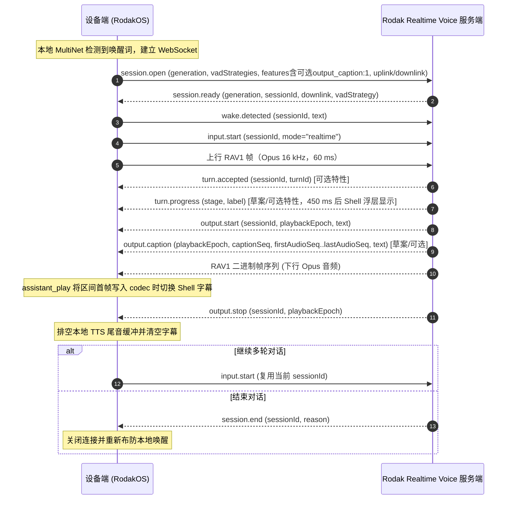
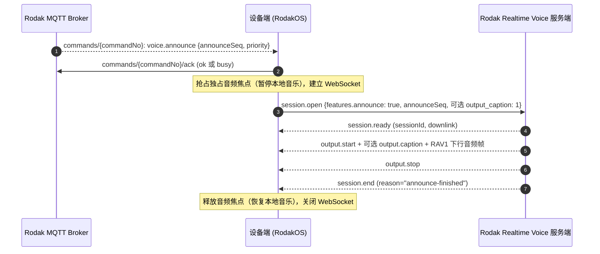

# RAV1 二进制音频帧、VAD 策略、多设备仲裁与主动播报实战

> **参考规范**：本文依据 [rodak-realtime-voice-contract-v1.md](https://github.com/rymcu/rodakos/blob/main/docs/rodak-realtime-voice-contract-v1.md) 整理，重点拆解实时语音数据面的 RAV1 音频帧封装、VAD 协商与多设备防撞机制，以及标准对话流与主动播报（Announce）两条核心业务链路。

> 音频格式有两层：下行表列的是线级 Opus 协商参数，[当前固件按本地 16 kHz](https://github.com/rymcu/rodakos/blob/38f16b0d2f916106349fd93206edf16854ccae8f/main/phone_os/voice_assistant_service.cc#L50-L68) 单声道 PCM 播放；不应据此修改握手中的下行能力。唤醒交接保持 ADC 打开。设备端插话[以发出打断前的播放状态](https://github.com/rymcu/rodakos/blob/38f16b0d2f916106349fd93206edf16854ccae8f/main/phone_os/voice_assistant_service.cc#L764-L790)区分自然结束和服务端确认，避免确认触发额外 input.start 而截掉插话；真正发生在已收到自然结束的本地尾音期，则按下一轮路径重新布防。

## 1. 音频编解码规格与 RAV1 二进制帧格式

### 1.1 上下行编解码参数与载荷上限

| 方向 | 编码格式 | 声道 | 采样率 | 帧长 |
| :--- | :--- | :--- | :--- | :--- |
| **上行（Uplink）** | Opus | 单声道（1 channel） | 固定 **16 kHz** | 固定 **60 ms** |
| **下行（Downlink）** | Opus | 单声道（1 channel） | 支持 `8 / 12 / 16 / 24 / 48 kHz`（示例默认 **24 kHz**） | 支持 `5 / 10 / 20 / 40 / 60 ms`（示例默认 **60 ms**） |

* **`maxAudioFrameBytes`**：仅约束 Opus 载荷本身的大小，默认 **8 KiB（8192 字节）**，协商上限最高 **64 KiB**。

### 1.2 RAV1 二进制帧结构（`12 + N` 字节）

上下行音频都不包装在 JSON 中；当前固件发送上行、接收下行时均使用 WebSocket 二进制消息及 RAV1 包头。每条二进制消息必须严格符合 `12 + N` 字节的 RAV1 封装格式：

| 字节偏移 | 长度（Byte） | 字节序 / 类型 | 校验规则 |
| :--- | :--- | :--- | :--- |
| `0` | `4` | ASCII 字符串 | 固定魔数 `RAV1`，不匹配立即拒绝。 |
| `4` | `4` | `uint32`（大端序） | 帧序列号，必须**非零**且在当前会话/代次内**严格递增**（必须大于上一帧序列号）。 |
| `8` | `4` | `uint32`（大端序） | 载荷长度 `N`，必须严格等于消息剩余字节数（`total_len - 12 == N`），且 `N <= maxAudioFrameBytes`。 |
| `12` | `N` | 二进制载荷 | 单个完整的 Opus 音频数据包。 |

> **实现提醒**：解析器必须同时校验“剩余长度精确匹配 `N`”与“序列号严格递增”，绝不能容忍粘包、截断包或乱序/重复序号帧进入 Opus 解码器。

## 2. 按 RAV1 帧区间同步的回复字幕（`output.caption`，§6.2 草案）

> **状态说明**：`output.caption` 为协议草案（§6.2，线级结构仍可演进），RodakOS 与 Rodak 均已落地实现。

由于设备侧 `VoicePlaybackQueue` 最多缓存 **50 帧（约 3 秒）**已解码 PCM 音频，若在网络收到字幕事件时立即刷新屏幕，文字会明显超前于扬声器发声。为此，协议将每句字幕绑定到同一播放轮次的 RAV1 音频帧序列号闭区间 `[firstAudioSeq, lastAudioSeq]`，固件在独立播放任务 `assistant_play` 把区间首帧**真正写入 codec** 的那一刻才切换屏幕显示：

```json
{
  "event": "output.caption",
  "sessionId": "rv-7f3c2a9e1b4d4c6a",
  "playbackEpoch": 1,
  "captionSeq": 1,
  "firstAudioSeq": 1,
  "lastAudioSeq": 32,
  "text": "明天北京晴，气温 6 到 18 度。"
}
```

### 2.1 协议硬规则与端侧显示语义

1. **协商前置（兼容旧固件）**：服务端支持字幕时在描述符 `features` 列出 `"output_caption"`；设备仅在观测到该特性时，在 `session.open` 中请求 `features.output_caption: 1`（普通唤醒与 Announce 播报会话均允许）。服务端**必须**仅在收到 `features.output_caption: 1` 后才下发 `output.caption`，避免旧固件因未知控制事件报错断连。
2. **显式轮次与帧区间边界**：仅在该 `playbackEpoch` 的 `output.start` 与匹配 `output.stop` 之间有效；无显式 `playbackEpoch` 的回复不发送字幕。每轮内 `captionSeq` 从 `1` 严格递增，`1 <= firstAudioSeq <= lastAudioSeq`，且各句帧区间互不重叠、严格递增。服务端应在区间首帧发送前下发字幕（若帧已播过，设备静默跳过而非报错）。
3. **文案长度与隐私约束**：`text` 经首尾空白裁剪后非空，最多 **48 Unicode 码点**且最多 **192 UTF-8 字节**（更长句子由服务端拆成多条字幕），仅放实际播报句，**严禁**包含用户原话、工具名或工具参数。设备将控制字符转为空格，且**绝不**将字幕正文写入串口日志（日志仅打印 `Caption shown: epoch=... seq=... bytes=...`）。
4. **协商后禁止 `output.start.text` 兜底污染**：一旦本会话协商了 `output.caption`，设备**绝不**使用 `output.start.text` 兜底显示（避免偶发漏字幕时把整段回复铺满屏幕）。仅在**未协商** `output.caption` 时，若 `output.start.text` 满足上述长度上限，设备才会从写入首帧起将其显示到本轮结束。
5. **端侧缓冲、清屏与全局浮层让位**：
   * `VoiceCaptionTimeline` 最多暂存 **12 条**超前于扬声器的字幕（超限丢弃最旧字幕，绝不丢音频）；一句播完后保持显示直至下一区间首帧写入，防止句间闪烁；打断、本地停止、错误、重连或尾音排空（`ClearPlaybackLocked`）立即清空。
   * `PhoneShell` 底部全局仿毛玻璃浮层在全应用生效（取代旧版 Home 顶栏进度，等待进度在 `turn.accepted` 后 450 ms 显示单行、播放时切换为最多两行字幕），按序让位于：锁屏 / 控制中心、软键盘、占用底部的应用（相机、Home 整理、展开的文件夹）、可见 Toast、任意 WebRTC 屏幕分享（只读与远程控制均在首帧前隐藏）及其他可点击顶层对话框；点击浮层可临时隐藏直至文本变化，且不做跑马灯滚动以节省 SPI 带宽。

## 3. VAD 策略与多设备协同机制

### 3.1 三种 VAD 策略的语义区别

设备在 `session.open` 中上报支持的 `vadStrategies` 与 `preferredVadStrategy`，服务端在 `session.ready` 中确定本次会话生效的 `vadStrategy`：

| 策略名 | 决策权归属 | 设备端行为要求 |
| :--- | :--- | :--- |
| `device-authoritative` | 设备端权威 | 以设备侧上报的 `vad` 事件（`start`/`end`）作为语音起止权威边界。 |
| `server-authoritative` | 服务端权威 | 设备正常上传音频流，但**抑制发送** `vad` 控制事件。若描述符未给出 `vadStrategies` 或 `session.ready` 未指定策略，**安全默认**采用此策略。 |
| `hybrid-fallback` | 混合兜底（**默认推荐**） | 正常由服务端判断边界；当服务端未及时返回边界时，设备侧可发送 `vad` 事件作为兜底。 |

### 3.2 同屋多设备唤醒仲裁与跨设备回声抑制

在家庭或办公环境中存在多台 RodakOS 设备时，服务端承担协同仲裁职责，设备端只需遵循标准协议即可无缝配合：

* **1.5 秒唤醒仲裁**：同一 Rodak 服务端下若有多台设备在 **1.5 秒**窗口内上报 `wake.detected`，服务端将其判定为同一次唤醒，仅响应最先到达的设备；其余落选设备会收到 `session.end`（`reason: "wake-arbitration-lost"`）并被服务端断开连接。落选设备无需编写特殊分支，按普通 `session.end` 流程重新布防本地唤醒监听即可。
* **跨设备回声抑制**：服务端会追踪各设备正在播报的回复文本，若某设备在采集窗口内识别出的语音内容与自身或其他设备正在播放的文本高度重合，服务端会自动将其作为回声丢弃（不改变线级协议格式，且不会下发 `turn.accepted`）。

## 4. 标准对话流与服务端主动播报（Announce）

### 4.1 标准多轮对话生命周期



### 4.2 服务端主动播报（Announce，纯下行模式）

由于设备空闲时不保持实时语音 WebSocket 长连接，家庭告警、定时提醒等主动播报场景采用 **MQTT 唤醒 + WebSocket 纯下行播报** 的两段式协同：



### 4.3 实现 Announce 模式必须遵守的 5 条硬约束

1. **严格纯下行**：不开启麦克风，**严禁**发送 `wake.detected`、`input.start`、`vad` 或任何上行音频。
2. **无对话状态（但可协商字幕）**：服务端不发送 `turn.accepted` / `turn.progress`，且该次播报不写入对话历史；若描述符列出 `output_caption`，Announce 的 `session.open` 仍可携带 `features.output_caption: 1` 启用播报字幕。
3. **独占音频焦点**：播报开始时抢占独占音频焦点（暂停本地音乐），播报结束后恢复。
4. **30 秒注册窗口与过期处理**：若 `announceSeq` 未知或超过 **30 秒**注册窗口，服务端直接返回 `session.end`（`reason: "announce-expired"`）。
5. **中断与零重连原则**：播报期间若触发本地唤醒或用户手动打断，设备直接关闭 WebSocket 终止播报（不转为普通对话）；**播报会话绝不触发自动重连**。

---

**下一篇推荐**：阅读《实时语音四重代次门控、超时重连与契约测试指南》，掌握防并发乱序的 4 层门控模型、重连退避矩阵、看门狗超时与自动化测试套件。
