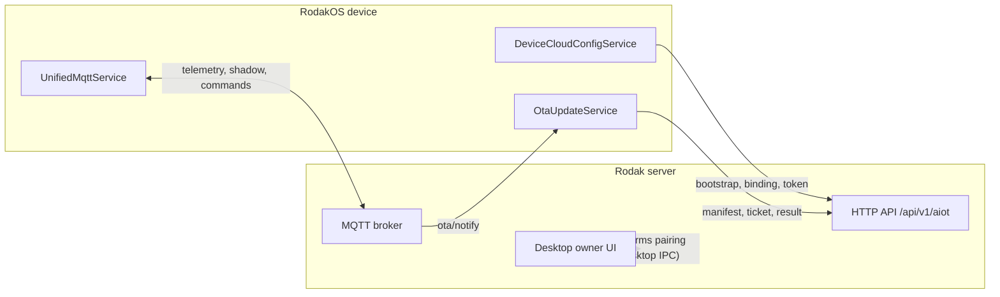
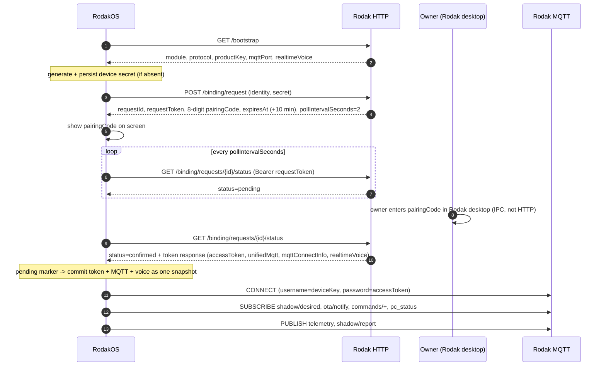
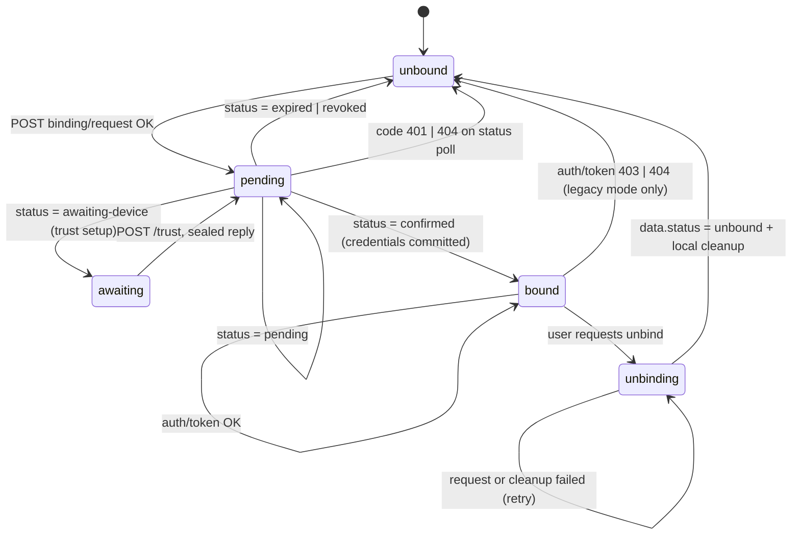
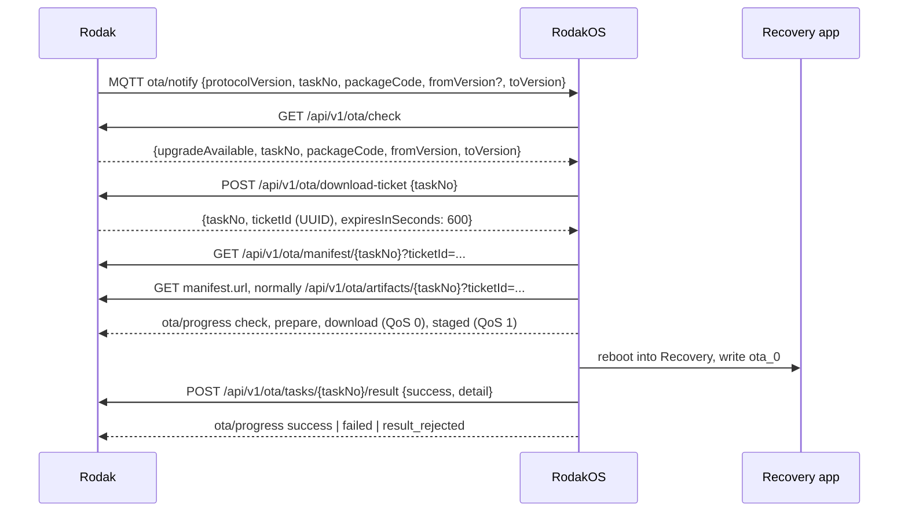

# Rodak AIoT v1 Cross-Repository Contract

> Contract: `rodak-aiot/v1`
> Canonical server: Rodak
> Firmware implementation: RodakOS `main/phone_os/`
> Machine-readable form: [`contracts/rodak-aiot/v1/`](../contracts/rodak-aiot/v1/README.md)
> Source of truth: the Rodak server's behavior. When this document and the server disagree, this
> document is fixed.

This document is the normative contract for device identity, owner binding, credentials,
unified MQTT, shadow state and OTA coordination. The keywords MUST, MUST NOT, SHOULD and MAY
are used as in RFC 2119. Text marked *Informative* describes the current implementation and
is not a requirement on the other side.

The realtime voice wire contract is separate: see
[Rodak realtime voice v1](rodak-realtime-voice-contract-v1.md). XiaoZhi compatibility is outside
this contract. Rodak currently has no XiaoZhi adapter.

## 0. Reading guide

| You are | Read | Then, if needed |
| --- | --- | --- |
| Implementing or changing the Rodak server side | §2, §4, §5, §7, §8, §9, §12 | [Command semantics](mqtt-command-semantics.md) |
| Building a device or simulator | §2–§9 | [Command semantics](mqtt-command-semantics.md), [Implementation notes](aiot-implementation-notes.md) |
| Maintaining RodakOS firmware | All | [Implementation notes](aiot-implementation-notes.md) |
| Checking a payload | §14 | `contracts/rodak-aiot/v1/schemas/` |

Detail is split into three layers:

| Document | Content |
| --- | --- |
| This contract | What each side MUST send and accept. |
| [MQTT command semantics](mqtt-command-semantics.md) | Replay ledger, exact stream Stop, stream leases, result queue limits. |
| [AIoT implementation notes](aiot-implementation-notes.md) | Firmware internals: volume/light/voice-identity evidence, codec overlay, test evidence. |

## 1. Overview and terms



| Term | Meaning |
| --- | --- |
| Device key | Stable device identity. Default: lowercase WiFi STA MAC, `aa:bb:cc:dd:ee:ff`. |
| Device secret | RodakOS: 32 random bytes as 64 lowercase hex. Sent as `deviceSecret` and `credentialSecret`. Rodak stores only its hash. Pairing accepts any nonempty trimmed string; token refresh limits it to 512 characters without control characters. |
| Request ID | 32 lowercase hex characters, issued by Rodak. |
| Request token | 32 random bytes as base64url (43 characters). Bearer for binding status polls and `/trust`. Trust setup replaces it once. |
| Access token | HS256 JWT with header `{"alg":"HS256"}`, claims `tv` and `exp`, plus a compact subset of `did`, `dk`, `pk` (§4.4). Used as MQTT password, HTTP bearer (OTA, unbind) and realtime voice bearer. |
| Envelope | Rodak HTTP response wrapper `{"code","message","data"}`. See §4.1. |
| Legacy mode | No installed server trust pin. Plain HTTP/MQTT is allowed. |
| Pin mode | A server trust anchor and fixed TLS name `rodak-<16 hex>.local`, installed over USB or by LAN trust setup. See [trusted server discovery](trusted-server-discovery.md), [LAN onboarding](lan-onboarding-design.md). |
| Authority | One server identity (origin + trust) that issued the current credentials. Replacing it clears device-side command state. |
| Board Manager | The Espressif board abstraction. Its board name `rymcu_bigsmart` is not the cloud product key. |

## 2. Onboarding sequence



A bound device with an expired token skips steps 3–9 and calls `POST /auth/token` (§4.4).

LAN trust setup (HTTPS listener, no USB) replaces the pairing code with an SRP exchange:
`binding/request` carries `trustSetup`, the status goes `pending → awaiting-device`, the device
posts its proof to `binding/requests/{id}/trust`, and the sealed reply carries the server trust and
a new request token. The confirmed poll then continues as above. See
[LAN onboarding](lan-onboarding-design.md).

## 3. Identity

| Field | Value |
| --- | --- |
| `protocol` | `rodak-aiot` |
| `protocolVersion` | `1` |
| `productKey` | `rymcu-bigsmart` |
| Board discriminator | `rymcu_bigsmart` in `board.type`. Rodak also reads `board.board_manager_type` and `board.name`. |
| `application.name` | `rodakos` |

- RodakOS MUST reject a bootstrap whose `module` is present and not `aiot`, whose `protocol` is
  present and not `rodak-aiot`, whose `productKey` is present and not `rymcu-bigsmart`, or whose
  `protocolVersion` is present and not `1`.
- RodakOS MUST NOT read legacy XiaoZhi bootstrap fields, WebSocket credentials or legacy NVS
  namespaces.

## 4. HTTP API

All paths are relative to the configured server origin. The device derives the origin from the
provisioned bootstrap URL.

Operations that RodakOS uses:

| Method and path | Auth | Request | Success `data` |
| --- | --- | --- | --- |
| `GET /api/v1/aiot/devices/bootstrap` | none | – | [bootstrap](../contracts/rodak-aiot/v1/schemas/bootstrap.schema.json) |
| `POST /api/v1/aiot/devices/binding/request` | none | [binding-request](../contracts/rodak-aiot/v1/schemas/binding-request.schema.json) | [binding-request-created](../contracts/rodak-aiot/v1/schemas/binding-request-created.schema.json) |
| `GET /api/v1/aiot/devices/binding/requests/{requestId}/status` | Bearer request token | – | [binding-status](../contracts/rodak-aiot/v1/schemas/binding-status.schema.json) |
| `POST /api/v1/aiot/devices/binding/requests/{requestId}/trust` | Bearer request token, HTTPS only | SRP proof | `{status: confirmed, sealed}` or `{status: revoked}` |
| `POST /api/v1/aiot/devices/auth/token` | none (secret in body) | [token-refresh-request](../contracts/rodak-aiot/v1/schemas/token-refresh-request.schema.json) | [token-response](../contracts/rodak-aiot/v1/schemas/token-response.schema.json) |
| `POST /api/v1/aiot/devices/binding/unbind` | Bearer access token | ignored | [unbind-response](../contracts/rodak-aiot/v1/schemas/unbind-response.schema.json) |
| OTA operations | Bearer access token | §12 | §12 |

Rodak also serves HTTP fallbacks that RodakOS does not use, all with the access token:
`POST /heartbeat`, `POST /telemetry`, `POST /shadow/report`, `GET /shadow/desired`,
`GET /commands/pull`, `POST /commands/{commandNo}/ack`, `POST /api/v1/ota/tasks/{taskNo}/progress`.
Appearance has its own routes under `/api/v1/aiot/appearance/`, see
[appearance customization](appearance-customization.md). All device operations except the Appearance
routes are in [`openapi.yaml`](../contracts/rodak-aiot/v1/openapi.yaml).

Rodak keeps `POST /devices/register` and `/devices/activate` as migration endpoints. For
`rymcu-bigsmart`, register returns business 403. They are not part of this contract. A device
MUST NOT use them.

### 4.1 Response envelope

```json
{"code": 200, "message": "获取配对状态成功", "data": { }}
{"code": 401, "message": "配对申请令牌无效", "data": null}
```

| Case | HTTP status | Envelope `code` | `data` |
| --- | --- | --- | --- |
| Success | 200 | 200 | route result |
| Business error (every route except Appearance) | **200** | 400, 401, 403, 404, 409, 410, 413, 429, 500, 503 | `null` |
| Appearance route error (`/api/v1/aiot/appearance/*`) | same as the code | 400–503 | `null`; an invalid artifact `Range` is HTTP 416 with an empty body |
| Access-token pre-handler rejected (missing, invalid, revoked) | **401** | 401 | `null` |

- A client MUST check the HTTP status and then the envelope `code`. In this document "401" means
  either source.
- *Informative:* RodakOS also accepts a body without an envelope and treats the root object as
  `data`. Rodak always sends the envelope.

### 4.2 Binding request

The device MUST generate and persist the device secret before it sends this request.

```json
{
  "protocol": "rodak-aiot",
  "protocolVersion": 1,
  "productKey": "rymcu-bigsmart",
  "deviceKey": "aa:bb:cc:dd:ee:ff",
  "deviceSecret": "<64 hex characters>",
  "credentialSecret": "<same secret>",
  "clientId": "<persistent client UUID>",
  "application": {"name": "rodakos", "version": "<firmware>"},
  "board": {"type": "rymcu_bigsmart", "productKey": "rymcu-bigsmart"}
}
```

What Rodak reads:

| Value | Read from, first present field wins | Rule |
| --- | --- | --- |
| Device key | `deviceKey`, `deviceCode` | Trimmed, 1–128 UTF-16 code units, no C0 control or DEL. Keep it short plain ASCII for MQTT (§4.4). |
| Product key | `productKey`, `credentialKey` | MUST be `rymcu-bigsmart` |
| Secret | `deviceSecret`, `credentialSecret`, `secret` | Manual pairing: the selected secret is required and nonempty after trim; no length limit at this step. Trust setup: the selected secret (`deviceSecret ?? credentialSecret`) MUST be empty, and the `secret` key MUST be absent. A whitespace-only selected secret is rejected in trust setup. |
| `trustSetup` | `{version: 1, srpSalt, srpB, seenSpki}` | HTTPS listener only |

"First" means the first field that is present (not `null`/absent). Rodak converts it to a string
and trims it, so a blank `deviceKey` hides a set `deviceCode`. If both the canonical field and its
alias are present with different values, Rodak returns 400. This applies to the device key and the
product key only; for the secret the first present field wins.

Rodak sets `protocol` itself. At confirmation it also reads `product_key`, `application`, `board`,
`deviceName`, `firmwareVersion` and `hardwareVersion` to build the device record. RodakOS sends
all of them.

Errors: 400 invalid input or alias conflict; 413 if the stored request (body without secrets and
without `trustSetup`, plus the secret hash for manual pairing) is over 64 KiB; 429 if 256 unexpired requests exist, the device already has
3 pending requests, or the same requester sent 20 requests in its current 60-second window (a
fixed window that starts at its first request); 503 pairing service
not ready.

The created response:

| Variant | Fields |
| --- | --- |
| Manual | `requestId`, `requestToken`, `pairingCode` (8 digits), `expiresAt` (ISO with milliseconds, +10 min), `status: pending`, `pollIntervalSeconds: 2` |
| Trust setup | `requestId`, `requestToken`, `trustSetup: {required: true}`, `expiresAt` (ISO, +5 min), `status: pending`, `pollIntervalSeconds: 1` |

The device MUST persist `requestId`, `requestToken`, `pairingCode` and `expiresAt` before it shows
the code.

### 4.3 Binding status

The device polls with `Authorization: Bearer <requestToken>`. Every status response contains
`requestId`, `deviceKey`, `productKey`, `status`, `requestedAt` and `expiresAt`, and when known
`deviceId`, `deviceName`, `confirmedAt` and `trustSetup`.

| `status` | Meaning | Extra fields |
| --- | --- | --- |
| `pending` | Waiting for the owner | – |
| `awaiting-device` | Trust setup: the owner entered the code; the device must post its proof | `trustSetup: {srpA, srpM1, serverBind}`, base64 of 384, 64 and 32 bytes |
| `confirmed` | Bound | The full token response (§4.4), spread over the status record. A confirmed record without `deviceId` returns the bare status record. A confirmed record whose device is no longer active or bound returns business 403. |
| `expired` | Past `expiresAt`, and the record still exists. Returned once, then the record is deleted. Rodak also purges expired records when it creates or lists requests, so a device can get 404 without seeing `expired`. | – |
| `revoked` | Cancelled by the owner, after 5 wrong pairing codes, by trust-setup failure, or by unbind | – |

- In a `confirmed` response with credentials, `expiresAt` is the **token** expiry in Unix seconds
  (a number), because the token response overwrites the pairing field. Otherwise (before
  confirmation, or the bare confirmed record without `deviceId`) it is an ISO string.
- Business 401: missing or wrong request token. Business 404: unknown request, or a request that
  was already removed after `expired`.
- *Informative:* RodakOS normalizes the value case-insensitively. It also treats `approved` as
  `confirmed` and `rejected` as `revoked`. Rodak sends neither.

### 4.4 Token response and refresh

`POST /auth/token` lets a bound device with no pending request get a new access token:

```json
{"protocol": "rodak-aiot", "productKey": "rymcu-bigsmart",
 "deviceKey": "aa:bb:cc:dd:ee:ff", "credentialSecret": "<64 hex characters>"}
```

Rodak reads the first nonblank string of, in this order: `credentialKey`/`productKey`,
`deviceCode`/`deviceKey`, and `credentialSecret`/`deviceSecret`/`secret`/`devicePassword`. It
ignores `protocol`.

A token response (from `/auth/token` or a confirmed status) always contains:

| Field | Value |
| --- | --- |
| `deviceToken`, `token`, `accessToken` | The same HS256 JWT |
| `tokenType` | `Bearer` |
| `expiresIn`, `tokenTtlSeconds` | Lifetime in seconds, at least 1 |
| `expiresAt`, `expires_at` | Expiry in Unix seconds |
| `deviceId`, `deviceKey`, `deviceCode` | Identity (`deviceCode` = `deviceKey`) |
| `productKey`, `credentialKey` | The device's product key (`rymcu-bigsmart` for RodakOS) |
| `activationStatus`, `activationRequired` | `1`, `false` |
| `unifiedMqtt` | §7.1 |
| `mqttConnectInfo` | camelCase counterpart of `unifiedMqtt` without `keepalive`, plus `endpoint`, `sslEndpoint`, `wsEndpoint`, `clientId`, `subscribeTopics`, `publishTopics`, `vendorType: rodak-local`, `authMode: device-jwt` |
| `realtimeVoice` | §11 |
| `mqttHost`, `mqttPort` | Pin mode only: the TLS name and the MQTTS port |

*Informative:* RodakOS reads the token from `deviceToken`, `accessToken`, `token` or `mqttToken`,
and drops a cached voice descriptor when `realtimeVoice` is absent. Rodak always sends it.

Refresh errors (business codes; Rodak never sends 401 here):

| Code | Cause |
| --- | --- |
| 400 | Missing, too long or control-character credential field |
| 403 | Product or secret mismatch, inactive device, or a `rymcu-bigsmart` device that is not paired |
| 404 | Unknown device |

| Mode | Device behavior on rejection (403 or 404) |
| --- | --- |
| Legacy | Clear token and MQTT configuration. Return to owner binding (§5). |
| Pin | Keep the identity. Report `credentials rejected`. Do not start pairing automatically. |

Routine token refresh MUST NOT create a new binding silently.

The access token is an HS256 JWT with header `{"alg":"HS256"}`. Its claims always include `dk`
(device key), `tv` (token version) and `exp`; `did` (device ID) and `pk` (product key) are added
while the encoded token still fits 255 characters. The MQTT broker compares `dk` with the MQTT
username.

### 4.5 Unbind

The device sends `Authorization: Bearer <accessToken>`. Rodak ignores the body; RodakOS sends
`{}`. Success:

```json
{"code": 200, "message": "设备已解除绑定", "data": {"deviceId": "6f1c2b9a-…", "status": "unbound"}}
```

Success deactivates the device and invalidates the token. A retry with the old token after a lost
reply therefore gets HTTP 401, not a second success.

## 5. Binding state machine



| From | Event | To | Device action |
| --- | --- | --- | --- |
| `pending` | `pending` | `pending` | MQTT and voice MUST stay disabled. |
| `pending` | `confirmed` | `bound` | Commit token, MQTT and voice as one snapshot (§6.1). |
| `pending` | `expired` or `revoked` | `unbound` | Clear the saved request. A new pairing needs an explicit user action. |
| `pending` | status poll 401 or 404 | `unbound` | Clear the saved request. |
| `pending` | `awaiting-device` | trust setup | Only `LanOnboardingService` handles it. The main pairing path fails closed. |
| `pending` | unknown value | `pending` | Fail closed. Do not enable Device Cloud. |
| `pending` | response without required fields or credentials | `pending` | Reject. Do not change the live configuration. |
| `bound` | unbind confirmed | `unbound` | Clear token, request, MQTT and voice. Keep WiFi and provisioning URL. |

*Informative:* RodakOS also clears the request on business 410. Rodak sends 410 only from `/trust`.

Unbind is server-confirmed. If the request or local cleanup fails, the state stays `unbinding`
and the device retries. The device MUST NOT report a completed unbind before both steps succeed.

## 6. Credentials and transport modes

### 6.1 Transaction rules

- AIoT identity, access token, realtime voice descriptor and unified MQTT values MUST be committed
  as one transaction.
- Before the device writes a candidate, it MUST persist a pending marker. After a reset with the
  marker set, the device MUST NOT use the candidate. The next boot retries or clears it according
  to the binding status.
- A failed commit MUST restore the previous complete snapshot.
- Passwords, access tokens, request tokens and device secrets MUST NOT appear in ordinary logs,
  serial replies or shadow payloads.

### 6.2 Legacy mode and pin mode

| Aspect | Legacy mode | Pin mode |
| --- | --- | --- |
| Trust source | Public CA or plain transport | Server certificate and TLS name `rodak-<16 hex>.local`, installed over USB or by LAN trust setup |
| HTTP | `http` or `https` | `https` on the pinned origin only |
| MQTT | Rodak omits `transport` | Rodak sends `transport: mqtts`; RodakOS requires it and requires broker host = pinned TLS name |
| `http_base_url` | Any; default is the bootstrap origin | MUST have the current HTTPS origin |
| Realtime voice | Rodak sends `ws://` (or `wss://` behind a trusted HTTPS proxy) | `wss://` on the pinned origin |
| Redirects, public-CA fallback | Allowed by the HTTP client | Disabled |
| OTA and Appearance downloads | Configured origin | Same certificate and TLS name |
| Token refresh rejected | Return to binding | Keep identity, report failure |
| Provisioning URL change | Clear AIoT, MQTT and voice before the next bootstrap | Stage endpoint and certificate as a candidate. Promote only after authenticated completion. |

Serial provisioning supplies WiFi, the bootstrap URL and an optional server trust anchor. It
never supplies MQTT or voice credentials. See [serial provisioning](serial-provisioning.md) and
[QR provisioning](qr-provisioning.md).

## 7. Unified MQTT

### 7.1 `unifiedMqtt` descriptor

The MQTT payload version (`protocol_version: 2`) is independent of the `rodak-aiot` protocol
version.

```json
{
  "protocol_version": 2,
  "broker_address": "rodak.local",
  "broker_port": 1883,
  "username": "aa:bb:cc:dd:ee:ff",
  "password": "<access token>",
  "keepalive": 240,
  "device_key": "aa:bb:cc:dd:ee:ff",
  "http_base_url": "http://rodak.local:8080",
  "http_bearer_token": "<access token>",
  "home_enabled": 0,
  "topics": {
    "telemetry": "devices/aa:bb:cc:dd:ee:ff/telemetry",
    "shadow_report": "devices/aa:bb:cc:dd:ee:ff/shadow/report",
    "shadow_desired": "devices/aa:bb:cc:dd:ee:ff/shadow/desired",
    "ota_notify": "devices/aa:bb:cc:dd:ee:ff/ota/notify",
    "ota_progress": "devices/aa:bb:cc:dd:ee:ff/ota/progress",
    "commands": "devices/aa:bb:cc:dd:ee:ff/commands/+",
    "pc_status": "devices/aa:bb:cc:dd:ee:ff/pc_status",
    "home_prefix": "rymcu/home/v1"
  }
}
```

Rodak always sends every field above:

- `username` = `device_key`. `password` = `http_bearer_token` = the access token.
- `keepalive` is always `240`. `protocol_version` is always `2`.
- `home_enabled` is the integer `0` or `1`. *Informative:* RodakOS ignores a JSON boolean here.
- `home_prefix` is the configured Home broker prefix, trimmed, default `rymcu/home/v1`. It is the
  same for all devices. The broker lets the device subscribe and publish under it.
  *Informative:* RodakOS v1 stores it and does not use it.
- Pin mode adds `"transport": "mqtts"`. Legacy mode omits `transport`.

*Informative:* defaults that RodakOS applies when a field is absent (for other servers):

| Field | Default |
| --- | --- |
| `broker_address` | Host of the bootstrap origin (legacy mode only) |
| `broker_port` | Bootstrap `mqttPort`, else `1883` |
| `username` | `device_key` |
| `password` | Access token |
| `device_key` | WiFi MAC device key |
| `http_base_url` | Bootstrap origin |
| `keepalive` | `240` |
| `protocol_version` | `2` |
| each topic except `home_prefix` | `devices/{deviceKey}/...` as in §7.3 |

### 7.2 Accepted aliases

*Informative.* Rodak sends the canonical names. RodakOS also accepts these aliases during the v1
compatibility window; the first match wins, in table order.

| Canonical | Also accepted |
| --- | --- |
| `unifiedMqtt` (token response) | `unified_mqtt`, `mqttConnectInfo`, `mqtt_connect_info`, `mqtt`; else the bootstrap object |
| `broker_address` | `brokerAddress`, `host`, `address`, `broker.address`, `broker.host`, `broker.brokerAddress`, bootstrap `mqttHost`/`mqtt_host` |
| `broker_port` | `brokerPort`, `port`, `broker.port`, `broker.brokerPort`, bootstrap `mqttPort`/`mqtt_port` |
| `protocol_version` | `protocolVersion` |
| `password` | `httpBearerToken`, `http_bearer_token` |
| `device_key` | `deviceKey` |
| `http_base_url` | `httpBaseUrl`, `baseUrl` |
| `home_enabled` | `homeEnabled` |
| `topics.shadow_report` etc. | camelCase form, for example `shadowReport`, `otaNotify`, `pcStatus`, `homePrefix` |
| `requestId`, `requestToken`, `pairingCode`, `expiresAt` | snake_case form |
| `realtimeVoice` | `realtime_voice` |

### 7.3 Topics

| Topic | Direction | QoS | Retain | Payload |
| --- | --- | --- | --- | --- |
| `devices/{k}/telemetry` | device → server | 0 | no | [telemetry](../contracts/rodak-aiot/v1/schemas/telemetry.schema.json) |
| `devices/{k}/shadow/report` | device → server | 0 | no | [shadow-report](../contracts/rodak-aiot/v1/schemas/shadow-report.schema.json) |
| `devices/{k}/ota/progress` | device → server | 0; RodakOS uses 1 for `stepCode: staged` | no | [ota-progress](../contracts/rodak-aiot/v1/schemas/ota-progress.schema.json) |
| `devices/{k}/effects/receipt` | device → server | 0 | no | [effect-receipt](../contracts/rodak-aiot/v1/schemas/effect-receipt.schema.json) |
| `devices/{k}/commands/{commandNo}/ack` | device → server | 0 | no | [command-ack](../contracts/rodak-aiot/v1/schemas/command-ack.schema.json) |
| `devices/{k}/shadow/desired` | server → device | 0 | no | [shadow-desired](../contracts/rodak-aiot/v1/schemas/shadow-desired.schema.json) |
| `devices/{k}/ota/notify` | server → device | 0 | no | [ota-notify](../contracts/rodak-aiot/v1/schemas/ota-notify.schema.json) |
| `devices/{k}/commands/{commandNo}` | server → device | 0 (device subscribes `commands/+`) | no | [command-request](../contracts/rodak-aiot/v1/schemas/command-request.schema.json) |
| `devices/{k}/pc_status` | server → device | – | – | No built-in producer; see below |
| `devices/{k}/inbox/changed` | server → device | 0 | no | [inbox-changed](../contracts/rodak-aiot/v1/schemas/inbox-changed.schema.json) (draft, §7.6) |

- The broker ACL allows exactly these device topics plus the Home prefix and its descendants.
  It does not check QoS or retain. The draft `inbox/changed` (§7.6) is not in the ACL yet; until it
  is, the device's subscription is refused and the message center relies on its HTTPS refresh.
- `effects/receipt` is fixed to `devices/{k}/effects/receipt`. It is not in `topics`, and
  `mqttConnectInfo.publishTopics` omits it, but the broker allows it.
- Each subscription triggers its own delivery: `shadow/desired` → the current desired snapshot;
  `commands/+` → pending commands; `ota/notify` → the latest active OTA task (a `manifestVersion: 2`
  task only if it has its signature); `pc_status` → nothing. A device therefore does not need to poll after reconnect.
- The device connects after WiFi has an address. It publishes telemetry and reported shadow
  after connect.
- `pc_status`: the subscription is allowed for firmware compatibility. Rodak has no built-in
  producer; a future host collector may forward data here. A silent topic is normal.
- *Informative:* Rodak can also publish other payloads on the current device's `devices/{k}/`
  topics, except `shadow/desired`. Devices MUST
  validate every inbound payload and MUST NOT assume that only the producers in this document
  write to these topics.

The channel definitions are in [`asyncapi.yaml`](../contracts/rodak-aiot/v1/asyncapi.yaml).

### 7.6 Message center (draft)

> Status: draft. RodakOS implements the device side and Rodak implements the server side: the token
> response lists `unifiedMqtt.topics.inbox_changed`, the broker allows that subscription, and the
> snapshot and action endpoints below answer. The wire shape can still change.

The server keeps notices and todo reminders for the bound device and decides separately whether
to also announce one by voice. `voice.announce` (§8.4) is a short-lived playback request and is
never a record: it has a 30 s claim window, skips offline devices and also carries voice-requested
music. A record therefore exists whether or not an announce was played, and a played announce is
no evidence that the user heard or read anything.

Four identifiers keep retries and old screens apart:

| Field | Meaning | Device action |
| --- | --- | --- |
| `noticeId` | One displayed record | Mark read |
| `todo.taskId` | The todo itself | Complete |
| `todo.occurrenceId` | The current reminder of that todo | Snooze 10, 30 or 60 minutes |
| announce sequence | One voice announce try (§8.4) | None; not a record |

Flow:

1. The server stores or changes a record, increases `inboxRevision` and publishes
   [`inbox/changed`](../contracts/rodak-aiot/v1/schemas/inbox-changed.schema.json) without message
   text. The signal may be lost, repeated or merged, and an empty payload is valid.
2. The device fetches `GET /api/v1/aiot/devices/inbox` on the pinned HTTPS origin with its access
   token. The data is an [inbox snapshot](../contracts/rodak-aiot/v1/schemas/inbox-snapshot.schema.json):
   the newest records first and `unreadCount` for all records. It fetches a full snapshot after
   boot, after rebinding and after a signal whose revision it does not hold, and at most every
   15 minutes otherwise.
3. The device sends `POST /api/v1/aiot/devices/inbox/actions` with an
   [action request](../contracts/rodak-aiot/v1/schemas/inbox-action-request.schema.json). The data
   is an [action result](../contracts/rodak-aiot/v1/schemas/inbox-action-result.schema.json).

Rules:

- The server sends only records that the household may see. The device lock screen is a swipe
  privacy cover without a PIN or personal identity.
- `opId` is chosen by the device. The server first looks up `opId` for the current binding and, for
  a repeat of the same request, returns the stored outcome. It then checks access,
  `expectedRevision` and, for snooze, that `occurrenceId` is still the current reminder. A request
  that lost its answer is therefore retried with the same `opId` and applied at most once.
- `conflict` means the record changed elsewhere, for example on the desktop. `item` carries the
  current state and the device shows it; it is not an error for the user. `rejected` is final.
- The server computes the snooze end time from its own clock. A snooze never moves a later
  reminder of a recurring todo, because it names one `occurrenceId`.
- Unbinding deletes the device's view; the records stay on the server for the household.

*Informative:* RodakOS behavior. The device keeps at most 40 records in RAM and writes none to NVS.
It truncates long text at a character boundary, rejects a snapshot with a malformed item, and
clears everything at unbind or rebind, discarding late responses. One worker task makes one
request at a time and waits while a voice session, a WebRTC stream, an OTA or an appearance
download is active. Known offline, completion and snooze are disabled; a request without an
answer shows 待核对 and is retried only with its original `opId`. The Home status bar shows only a
red dot while something is unread, and the Lock Screen shows counts only.

*Informative:* Rodak behavior. Records are household-visible todos and household notices for the
agent of the device's own home: the agent it is bound to when that agent belongs to the same home,
otherwise that home's default assistant. A device whose home is not established (several homes and
no room assignment, or a room whose home is disabled), or whose bound agent belongs to another
home, gets an empty list; the server never falls back to another home. Completed todos
stay visible for 24 hours. Each device has its own `inboxRevision`, per-record `revision` and read
state; read state follows the reminder, so the next reminder of a recurring todo is unread again.
The server publishes `inbox/changed` right after the device subscribes and when its list changes,
checked every 30 s. An `opId` is kept for 7 days per binding; the same `opId` with a different
request returns business code `409`.

Hardware evidence (2026-11-27, BigSmart with Rodak): a server-side change produced `inbox/changed`
and a device sync within a second; a snooze of +10 minutes and a completion tapped on the device
were each applied once on the server with their own `opId`, and the device stayed up.

## 8. Commands

### 8.1 Envelope

A command arrives on `devices/{k}/commands/{commandNo}`. Rodak's command numbers: ordinary =
dashless UUIDv4 (32 hex); stream Start = `rodak-video-start-<32 hex>`; stream Signal =
`rodak-video-<32 hex>`; stream Stop = `rodak-video-stop-<32 hex>`. The payload is a JSON object
with `command` (or `type`) and command fields. `ping` may also be bare text or a JSON string.
Managed stream commands also carry `_meta["rodak/videoSignal"]: {schema: "rodak.videoSignal.v1",
dispatchId}`; RodakOS ignores `_meta`.

The device replies once on `devices/{k}/commands/{commandNo}/ack`:

```json
{"status": "ok", "result": {"pong": true, "firmware": "1.4.0"}}
{"status": "error", "errorCode": "unsupported_command"}
```

`ok` means accepted. For asynchronous commands it does not mean completed (§10).

### 8.2 Command list

| Command | Required fields | Success `result` | Detail |
| --- | --- | --- | --- |
| `ping` | – | `{pong: true, firmware}` | – |
| `voice.announce` | `announceSeq`, `priority` (`normal` or `urgent`; Rodak always sends it) | none | §8.4 |
| `camera.stream.start` / `display.stream.start` | Rodak sends `sessionId` (UUIDv4), `transport`, `width: 320`, `height: 240`, `fps: 5`, `expiresAt`, and `clientId` when set; only display adds `quality: 65`. RodakOS requires only `sessionId`. | `{sessionId, transport: "webrtc-datachannel", startCommandNo}` | [Peer integration](esp-peer-integration.md) |
| `camera.stream.stop` / `display.stream.stop` | `sessionId`, `startCommandNo` (Rodak always sends it; RodakOS also accepts its absence) | `{sessionId, startCommandNo, stopOutcome}` | [Exact Stop](mqtt-command-semantics.md#exact-stream-stop-026) |
| `camera.stream.signal` / `display.stream.signal` | `sessionId`, `type` (`sdp`/`candidate`), base64 `data` | `{sessionId}` | [Peer integration](esp-peer-integration.md) |

Any other command returns `unsupported_command`. There is no `volume.set` command. Volume and
light change through desired shadow (§9.3).

Camera and display sessions are mutually exclusive. Later stream callbacks reuse the Start
command's `/ack` topic with `result.cameraStream` or `result.displayStream`. These are sideband
messages. They never settle the command or replace its first result.

How Rodak classifies an ordinary ACK:

1. Sideband: top-level `event: signal|state`, or a `cameraStream`/`camera_stream`/`displayStream`/
   `display_stream` result whose `event` is `signal`/`state` or whose `type` is `sdp`, `offer`,
   `candidate` or `ice-candidate`.
2. Failure: `status: "error"` or `ok: false`. Any `errorCode` string is accepted; the detail comes
   from `errorMessage`, `message`, `errorCode` or `error_code`.
3. Otherwise success, including raw text.

Stream Signal and Stop ACKs additionally need matching session evidence; raw text does not
settle them. The first terminal result is frozen.

### 8.3 Error codes

| `errorCode` | Cause |
| --- | --- |
| `unsupported_command` | Unknown command, or a known command with no handler result. |
| `invalid_payload` | Malformed fields, ambiguous duplicate keys, embedded NUL, bad `announceSeq`. |
| `missing_session_id` | Stream command without `sessionId`. |
| `invalid_start_command_no` | `startCommandNo` present but empty, non-string or over 128 bytes. |
| `invalid_signal` / `invalid_signal_encoding` | Bad signal `type`/`data`, or `data` is not valid base64. |
| `camera_stream_unavailable` / `display_stream_unavailable` | No stream service on this build. Checked before session validation. |
| `camera_stream_busy` / `display_stream_busy` | Another stream is active. |
| `camera_stream_start_failed` / `display_stream_start_failed` | Native start failed. |
| `camera_stream_not_found` / `display_stream_not_found` | Unknown session, wrong `startCommandNo`, wrong kind, or stale proof. |
| `camera_signal_rejected` / `display_signal_rejected` | The peer rejected the signal. |
| `stream_instance_capacity_exceeded` | Instance nonces are exhausted. |
| `stream_lease_expired`, `command_scope_expired` | The connection epoch or authority changed during the command. |
| `voice_unavailable` | Build has no voice announce handler. |
| `busy` | `voice.announce` while the assistant is busy, or the command queue is full. Rodak records an ordinary failed command and does not retry it. |
| `command_conflict` | Same `commandNo`, different payload bytes. |
| `command_result_unavailable` | Same `commandNo`, but the cached reply was not retained. The original may have been applied. |
| `command_limits_exceeded`, `command_hash_failed`, `command_capacity_exceeded` | Replay ledger admission failure. |

### 8.4 `voice.announce`

```json
{"command": "voice.announce", "announceSeq": 17, "priority": "normal"}
```

Server side:

- Rodak skips the dispatch if the device is inactive or offline, or already has a pending or
  claimed announce.
- `announceSeq` is a per-process counter starting at 1. *Informative:* Rodak has no upper cap;
  RodakOS rejects values above 4294967295 with `invalid_payload`.
- *Informative:* Rodak can also send other commands, including plain text, verbatim and without
  a 256 KiB check. RodakOS validates every command and enforces its own limits.
- Rodak registers the text for 30 seconds. The device must open the playback-only voice session
  and claim it within that window. A late claim gets `session.end` with reason `announce-expired`.
- Rodak discards stale persisted announce commands on later pull or reconnect, also after a
  restart. A retried notice gets a new `announceSeq`.

Device side:

- The command carries no text. The server sends the spoken content only inside the authenticated
  voice session. See [realtime voice §8](rodak-realtime-voice-contract-v1.md#8-server-initiated-announce).
- Validation runs before the handler check: an invalid `announceSeq` returns `invalid_payload`
  even on a build without voice (`voice_unavailable`).
- Only the exact string `"urgent"` is urgent. Any other value, or no value, means `normal`.
- The device accepts only when the voice assistant is idle: no interaction, start, audio focus,
  transport or audio task is in progress. A `normal` announce also requires local music to be
  stopped. An urgent announce pauses music and resumes it afterwards.
- On acceptance the device queues the session open and replies `{"status":"ok"}`. If the open
  fails later, the device logs the stage and sends no second ACK. Rodak's 30-second claim window
  covers this case.

### 8.5 Replay summary

- The device keeps the latest 64 command numbers per authority. The same `commandNo` with the
  same payload bytes replays the original ACK without re-execution. Different bytes return
  `command_conflict`.
- Reboot, eviction and authority replacement remove this guarantee.
- The server MUST use a new `commandNo` for each new command and a new Start `commandNo` for each
  stream instance.
- Rodak records the first terminal result per command and does not overwrite it with later
  replies.

The full rules are in [MQTT command semantics](mqtt-command-semantics.md).

## 9. Shadow and telemetry

### 9.1 Telemetry

| Field | Type | Present when |
| --- | --- | --- |
| `firmware` | string | always |
| `wifi_rssi` | integer dBm | WiFi associated |
| `volume` | integer 0–100 | audio output exists |
| `battery` | integer 0–100 | ADC read succeeded |
| `charging` | boolean | charging state valid |
| `free_heap`, `minimum_free_heap_size`, `uptime_ms` | integer | always |
| `ota_slot` | string | always |

A failed battery read MUST omit the field. The device MUST NOT publish a guessed value.

*Informative:* this is the RodakOS emission profile. Rodak accepts any object, reads `firmware`
or `firmwareVersion`, and only logs a warning for fields outside the thing model.

### 9.2 Reported shadow

| Field | Content |
| --- | --- |
| `firmware` | Firmware version |
| `volume` | Accepted output configuration, 0–100 |
| `light` | `{id, available, last_error, configurationRevision, application, enabled, brightness, color{r,g,b}}` |
| `battery`, `charging` | As in telemetry |
| `appearance` | Appearance state, see [appearance customization](appearance-customization.md) |
| `voice_identity` | §9.4 |

Rodak stores the whole flat object as the new reported snapshot, increments the shadow version,
and merges `voice_identity` specially. Connect and unrelated state changes also publish reported
shadow. A reported value is a snapshot. It is not evidence that a particular desired change
executed (§10).

### 9.3 Desired shadow

Rodak always sends the full snapshot:

```json
{
  "deviceKey": "aa:bb:cc:dd:ee:ff",
  "shadowVersion": 42, "version": 42,
  "desired":  {"volume": 30},
  "reported": {"firmware": "1.4.0", "volume": 60},
  "state": {"desired": {"volume": 30}, "reported": {"firmware": "1.4.0", "volume": 60}},
  "_meta": {"rodak/shadowWrite": {"dispatchId": "a3bb189e-…"}}
}
```

- `shadowVersion` and `version` are equal. A new shadow has version `0` and empty maps. Each
  stored report and each desired write increments the version.
- Every MQTT publication has exactly one `_meta` entry: `rodak/shadowWrite` (ordinary sync,
  including the snapshot sent on subscribe) or `rodak/deviceEffect` (correlated effect, below).
  `GET /shadow/desired` over HTTP returns the same snapshot without `_meta`.
- Rodak validates the desired map only as JSON (at most 64 KiB, depth 32, plain objects, no
  `__proto__`, `constructor` or `prototype` keys), except `voice_identity`. A `volume` can therefore
  be any JSON value. *Informative:* RodakOS acts on an integer `volume`
  and object `light`/`appearance` and ignores other types.

The device reads fields from root `desired` or from `state.desired`:

| Field | Rule | Detail |
| --- | --- | --- |
| `volume` | Integer, clamped to 0–100 | [Volume effects](mqtt-volume-effects.md) |
| `light` | Patch of a discovered RGB light. No `id` selects the first light. | [Light effects](mqtt-light-effects.md) |
| `appearance` | Appearance deployment | [Appearance customization](appearance-customization.md) |
| `voice_identity` | §9.4 | [Voice identity](voice-identity-wake-word.md) |

Root `version` or `shadowVersion` is an ordering watermark. A correlated desired message carries
`_meta["rodak/deviceEffect"]`:

| `schema` | `operation` | `requested` |
| --- | --- | --- |
| `rodak.mqtt-volume-effect.v1` | `volume.set` | `{volume}` |
| `rodak.mqtt-light-effect.v1` | `light.patch` | `{lightId, patch}`; `patch` has only `enabled`, `brightness`, `color{r,g,b}` |

plus `effectId` (volume: UUIDv4; light: `light:<frame shadowVersion>:<UUIDv4>`), `parametersHash`
(SHA-256 hex), `dispatchId` (UUIDv4) and `shadowVersion`. The
device publishes the result on `effects/receipt`, never in reported shadow. One metadata object
selects one domain only.

The receipt has exactly one of `receipt` and `errorCode` (`stale-shadow`, `effect-conflict`,
`effect-capacity`, `invalid-request`, `outcome-unknown`). Rodak accepts it only if it is at most
16 KiB and `effectId`, `parametersHash`, `dispatchId`, `shadowVersion` and the original MQTT
connection match the pending dispatch. A `receipt` must also have `physicalVerified: false` and
`persistence: volatile`. An error-only result does not need these fields; Rodak ignores extra root
fields. Domain rules: [volume effects](mqtt-volume-effects.md),
[light effects](mqtt-light-effects.md).

### 9.4 Voice identity

```json
{"voice_identity": {"name": "罗达克", "wakeWord": "你好达克", "wakeCommand": "ni hao da ke",
                    "mode": "persistent", "revision": 1}}
```

- `mode` is `persistent` or `temporary`. A new or changed temporary identity MUST have a future
  absolute Unix millisecond `expiresAtMs` (a safe integer). Rodak can republish an unchanged
  temporary identity after it expired; the device then reports `expired`. Rodak omits
  `expiresAtMs` for a persistent identity.
  *Informative:* RodakOS also accepts `expiresAtMs: 0` there.
- `revision` is a positive uint32. Text fields are trimmed and nonempty, with no C0 control or
  DEL. `name` and `wakeWord` are at most 32 UTF-8 bytes, `wakeCommand` at most 128.
- Reported state adds `status` (`applied`, `expired`, `pending`, `pending_clock`, `rejected`,
  `recovery_failed`), `runtime`, `model`, `revisionWatermark` (at least the revision, at most
  uint32), `activeConfirmed` and optional `error`.
- A revision at or below the watermark MUST NOT reactivate. The same revision with different
  content is rejected.
- `voice_identity` has its own revision semantics. It MUST NOT be treated as a volume receipt.

## 10. Evidence levels

Each signal proves only its own level. Higher levels are not implied.

| Level | Signal | Proves | Does not prove |
| --- | --- | --- | --- |
| L0 | MQTT publish completes | The SDK accepted the message | Broker or device receipt |
| L1 | Command ACK `ok` | The device admitted and accepted the command | Completion, playback, physical effect |
| L2 | Reported shadow value | The device's current accepted configuration | That a specific desired change caused it |
| L3 | Effect receipt (`effects/receipt`) | One correlated effect reached the stated software stage | Physical output |
| L4 | Hardware observation | Physical effect | – |

The firmware currently claims at most L3 for volume and light, with `physicalVerified: false`.
Rodak's local desired-state compensation does not prove physical restoration.

## 11. Realtime voice handoff

Rodak sends `realtimeVoice` in both the bootstrap and every token response. It MUST satisfy the
[realtime voice v1 contract](rodak-realtime-voice-contract-v1.md). Rodak's value: endpoint
`<ws|wss>://<http origin>/api/v1/aiot/devices/realtime-voice`, Opus 16 kHz up and 24 kHz down,
60 ms frames, limits 8192/65536, all seven capabilities, all twelve events, all three VAD
strategies, preferred `hybrid-fallback`. *Informative:* RodakOS treats the descriptor as optional
so that it also works with MQTT-only servers.
RodakOS stores the descriptor with the AIoT token and sends the same access token as
`Authorization: Bearer`. It MUST NOT accept a legacy XiaoZhi WebSocket object instead.

## 12. OTA



- Task numbers have the form `ota_<epoch ms>_<8 hex>`.
- All OTA HTTP calls use `http_base_url` and `Authorization: Bearer <access token>`.
- Rodak does not notify a v2 task that has no per-task signature.
- The manifest RodakOS installs MUST have `manifestVersion: 2`, matching `taskNo` and `version`,
  `packageCode`, `fileSize > 0`, `checksumType: sha256` with 64 lowercase hex characters,
  `signatureType: rsa2048-sha256` and a 512 lowercase hex `signatureValue`, optional
  `signingKeyId`. The signature is RSA PKCS#1 v1.5 SHA-256 over:

  ```text
  rodakos-ota-v2\nrymcu-bigsmart\nota_0\nrsa2048-sha256\n<taskNo>\n<version>\n<fileSize>\n<checksumValue>\n
  ```

  *Informative:* Rodak can also serve legacy manifests and external URLs. RodakOS rejects them.
- Manifest errors are business codes: 403 invalid or expired ticket, 404 no owned task, 409
  terminal task or missing signature.
- The artifact route returns HTTP 200 with the image, or HTTP 206 for a satisfiable `Range`.
  Errors (ticket, ownership, terminal task, missing file) use the business code as the HTTP status
  (403, 404, 409) with the JSON envelope. The device MUST NOT write a non-2xx body as firmware.
- `Range` follows RFC 9110 for one range: `bytes=a-b`, `bytes=a-` and the suffix `bytes=-N`
  (last N bytes) give 206, with an end past the file clipped. A start at or past the file size,
  or `bytes=-0`, gives HTTP 416 with `Content-Range: bytes */<size>`. A malformed range, `b < a`
  or several ranges are ignored: full image, HTTP 200. *Informative:* RodakOS does not send
  `Range`.
- When Rodak attaches the signature itself, it checks the format (512 lowercase hex) and verifies
  the RSA signature only if the attachment request supplies a nonblank `publicKeyPem`. When
  serving, Rodak starts from the stored manifest snapshot, overwrites `taskNo`, `packageCode`,
  `version`, `fileSize`, `checksumType` and `checksumValue` from the task, package or artifact (a
  value can be absent for a legacy external package). `url` is the hosted artifact URL, built from
  the request's HTTP origin (in pin mode, the pinned TLS name and HTTPS port) and the current
  ticket, or else the snapshot's trimmed external URL.
  If the task has an attached
  signature, also overwrites `signatureType` and `signatureValue`; `signingKeyId` comes from the
  attachment, or from the snapshot if the attachment has none. RodakOS always verifies the signature
  itself.
- The device verifies size, SHA-256 and signature before Recovery writes `ota_0`.
- Progress never completes a task. Only `POST /tasks/{taskNo}/result` records `succeeded` or
  `failed`. `success` MUST be a JSON boolean; any other type is business 400 and does not change
  the task.
- *Informative:* on MQTT, Rodak keeps `stepCode` only as a trimmed nonblank string, coerces
  `progressPercent` with `Number()` (non-finite → 0, no range clamp) and drops `detail`. Over HTTP
  it passes `Number(progressPercent ?? 0)` unchanged. Both HTTP progress and result can return
  business 404 for an unknown or foreign task. The step list
  in the diagram is the RodakOS emission profile.
- Failure `errorCode` values (for example `MANIFEST_INVALID`, `SIGNATURE_INVALID`,
  `SD_SPACE_LOW`) and the journal, rollback and confirmation rules are in
  [MQTT and SD Recovery OTA](mqtt-ota-sd-recovery.md).

## 13. Ownership

| Concern | Owner |
| --- | --- |
| Device identity and credential persistence | `DeviceCloudConfigService` |
| MQTT connection, topics, shadow, commands, telemetry | `UnifiedMqttService` |
| OTA download, journal, Recovery handoff, result | `OtaUpdateService` and the factory Recovery image |
| Voice identity policy | `VoiceWakeService` through shadow |
| Realtime voice transport | `RodakRealtimeVoiceTransport`, under `rodak-realtime-voice/v1` |
| XiaoZhi compatibility | None. XiaoZhi is not a RodakOS wire or credential path. |

## 14. Machine-readable contract and verification

[`contracts/rodak-aiot/v1/`](../contracts/rodak-aiot/v1/README.md) holds:

- `openapi.yaml`: the HTTP operations of §4 and §12.
- `asyncapi.yaml`: the MQTT channels of §7.3.
- `schemas/*.schema.json`: JSON Schema 2020-12 for each payload.
- `examples/valid/` and `examples/invalid/`: fixtures that each schema MUST accept or reject.
  Most valid fixtures share one device, one OTA task and Rodak's real ID formats. Each binding
  request ID is one scenario (manual, trust setup, expired, revoked). Fixtures named for an edge
  rule (for example `binding-request.ascii-key-128-plus-space`) are standalone. The OTA signature verifies
  with `examples/ota-signing-public-key.pem` (test key only).

Schema profiles:

| Payload direction | Schema describes |
| --- | --- |
| Rodak → device (HTTP responses, desired, notify, commands) | What Rodak emits. |
| Device → Rodak (requests, telemetry, report, ACK, receipt, progress) | What RodakOS emits. The schema description states where Rodak accepts more; invalid fixtures there are RodakOS-profile negatives that Rodak may still accept. |

`python3 tools/check_aiot_contract.py` validates every fixture, every schema reference and the OTA
fixture signature. Rodak maintains the authoritative copy of these schemas and validates real
server responses against them; this repository mirrors it byte for byte.
The RodakOS host test `contract_fixture_test.cc` feeds the same fixtures to the firmware parsers.

Rodak's code is the source of truth. When it changes a wire shape, update this document, the
schema and the fixtures in one change. The alias table in §7.2 and the *Informative* notes
describe what RodakOS also accepts.

Other verification anchors:

- RodakOS host tests: `device_pairing_protocol_test.cc`, `device_pairing_policy_test.cc`,
  `mqtt_credential_refresh_policy_test.cc`, `voice_identity_test.cc`,
  `realtime_voice_contract_test.cc`, `tests/mqtt_volume_service/`.
- Rodak server tests cover pairing, token refresh, MQTT, shadow, commands, announce and OTA, and
  validate real responses against `contracts/`.
- The firmware `voice.announce` path has no host test. It needs device validation.
- Device workflow: [serial provisioning](serial-provisioning.md) and the Recovery-safe
  `flash_and_test.ps1` path.

Current test counts and build evidence are in [AIoT implementation notes](aiot-implementation-notes.md#verification-evidence).

## 15. Changelog

| Date | Change |
| --- | --- |
| 2026-11-27 | Draft message center (§7.6): `inbox/changed` dirty signal, `GET /api/v1/aiot/devices/inbox` snapshot and `POST /api/v1/aiot/devices/inbox/actions` with `opId` and `expectedRevision`. RodakOS implements the device side; the server side is not implemented. |
| 2026-11-20 | Corrected to the server's behavior: business errors keep HTTP 200 (except the artifact route and access-token rejection); binding statuses `pending`/`awaiting-device`/`confirmed`/`expired`/`revoked`; confirmed `expiresAt` is Unix seconds; `/auth/token` rejects with 400/403/404; full token response with `mqttConnectInfo`; `home_enabled` is an integer; desired shadow carries both state copies and `_meta`; `realtimeVoice` is always sent; stream commands carry `rodak/videoSignal`; OTA notify/check/ticket/manifest fields; OTA result needs a boolean `success`; artifact `Range` follows RFC 9110. Added `/trust`, the HTTP fallbacks and cross-field schema rules. |
| 2026-11-20 | Split into contract, [command semantics](mqtt-command-semantics.md) and [implementation notes](aiot-implementation-notes.md). Added diagrams, tables and `contracts/rodak-aiot/v1/`. |
| 2026-11-05 | Rodak's `rymcu-bigsmart` thing model declares the reported light fields. |
| 2026-10-26 | Rodak stopped sampling PC status itself. A future host collector may forward data to `pc_status`. |
| 2026-10-21 | Session-scoped voice MCP volume path removed ([archive](archive/2026-10-21-voice-volume-mcp.md)). |
| 2026-10-06 | Exact stream Stop (026) with `startCommandNo` and `stopOutcome`. |
