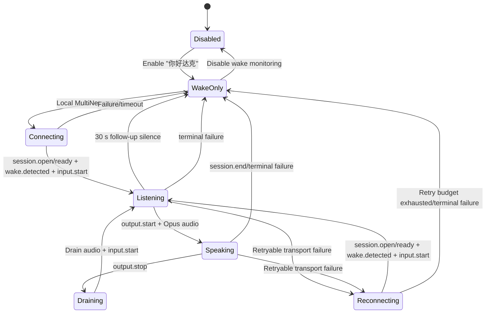

# Voice Assistant Integration

RodakOS provides a multi-turn voice assistant backed by Rodak. The device performs local wake
monitoring for **"你好达克"** and opens the cloud voice session only after a successful local
detection. One wake continues across replies on the same WebSocket until `session.end`, 30 seconds of
follow-up silence, or a terminal failure ends the session. A retryable failure in an established
interaction recovers with bounded backoff. Idle standby never keeps a cloud voice session open.
The normative wire details live in [Rodak realtime voice v1](rodak-realtime-voice-contract-v1.md).

## Product Boundaries

- ESP32-S3 owns wake detection, microphone capture, Opus encode/decode, playback, audio focus, and
  the device-side state machine.
- Rodak owns ASR, intent/agent execution, LLM generation, TTS, conversation state, and audit data.
- Idle wake monitoring is local. It must not keep a WebSocket, ASR stream, or cloud session alive.
- The Assistant app is a configuration and status surface. It is not a Talk/Stop interaction page.
- If the `voice_wake/enabled` preference is missing, the device sets it to enabled and commits it
  to NVS. A
  subsequent explicit disable remains authoritative across app launches and device restarts.
- Device Cloud, provisioning, WiFi, MQTT, and OTA remain system services consumed by the assistant.
  the assistant does not duplicate their configuration or lifecycle.
- Wake handling uses the canonical `realtimeVoice` descriptor and the AIoT device token from
  Device Cloud. After microphone capture starts, a new wake verifies token freshness on the existing
  internal-stack wake worker and refreshes expired or unverified credentials with the paired device
  secret. A valid token is reused until shortly before its advertised `expiresIn`. Monotonic expiry
  is kept only in RAM, so a reboot requires verification again. This does not create a new pairing.
  Reconnect uses the prepared RAM snapshot without NVS access. An expired snapshot ends that
  interaction, and the next wake refreshes credentials. HTTP authentication rejection is not retried.
  MQTT also refreshes once before its first connection after boot so cached broker addresses can
  follow the configured bootstrap server. A transient bootstrap failure retains the cached fallback.
  Credential preparation uses a shared three-second budget for lock waiting and HTTP stages.
  This is cooperative: an in-flight DNS or HTTP library call can return later, after which its
  result is rejected. Immediate Stop cancellation during those calls remains a hardware gate.
- A refresh needs two new HTTPS requests (bootstrap, then token). On a slow link these do not fit
  in three seconds. On a laptop hotspot one WebSocket connect took a median of 1.9 s (0.9 s on the
  router), and every wake after the token expired failed in preparation. To prevent this, the MQTT
  worker renews the token in the background before it expires. Renewal starts a quarter of the token
  lifetime before expiry, between 60 s and 300 s, and never earlier than half the lifetime. A
  3600 s token renews 300 s early, before the 30 s margin at which a wake would refresh it. Renewal
  runs only while MQTT is connected, no voice session is active, and no MQTT recovery is pending. It
  takes the refresh lock without waiting, so a wake, OTA or MQTT recovery that is already
  refreshing goes first. Renewal has a 20 s budget. If it fails on the network, the current token
  stays in use, the diagnosis and error shown before the renewal are restored, and renewal retries
  after 15 s, doubling to at most 8 minutes. A credential rejection or a configuration change stops
  renewal and keeps its diagnosis for the next wake. Rodak issues the renewed token with the same
  token version, so a session that uses the previous token is not revoked. The renewal timing is in
  `main/phone_os/cloud_credential_renewal.h`.
- A preparation can wait for the refresh lock while another refresh holds it. Appearance, for
  example, prepares credentials every 5 s, and a background renewal holds the lock for about 3.7 s
  on a hotspot. A preparation that waited for the lock does not write the shared diagnosis or error
  when its budget runs out. The refresh that held the lock writes its own. If that refresh left a
  fresh token, the preparation uses it even though its budget is spent. Otherwise it fails for its
  caller only. A preparation that did not wait for the lock still reports its own timeout.

## Device Cloud Diagnosis and Recovery

The Assistant status distinguishes an unconfigured binding, rejected credentials, credentials that
need refresh, a failed refresh, an unreachable server, unavailable voice capability, invalid
server trust, and low device memory. Low device memory means the voice WebSocket client or its task
could not be allocated, before any network I/O. It is not a server or credential fault. `DeviceCloudConfigService` holds the current typed diagnosis in RAM. UI polling does
not read NVS or parse certificates. Refresh failures remain visible across ordinary configuration
reads, while a later successful refresh replaces them. Superseded configuration requests cannot
publish a diagnosis for the new configuration. A shared RAM revision orders cloud and voice
diagnoses even within one millisecond. Refresh, rejection and expiry each advance it. Diagnostic
messages and recovery hints are fixed text. Server error bodies, tokens and device secrets are
not displayed or included in failure logs.

An idle or failed Assistant shows **Ready** only when the selected diagnosis is ready.
credential preparation shows **Preparing**, and a remaining diagnosis shows **Needs attention**.
Connecting, listening and speaking keep their actual interaction phase. These labels do not change
the local wake switch or start a voice session. When wake is disabled and the inactive Assistant's
diagnosis is otherwise ready, it shows **Disabled**, **Wake disabled** and **Enable wake to start.**
Re-enabling wake restores the ready guidance. Credential, network and trust diagnoses still take
priority over this disabled guidance.

The bottom **Settings > Device Cloud** control opens the existing Settings app. Select its
**连接与云服务** page to retry or repair provisioning. This is a two-step route, not a new provisioning
surface. A bound device keeps its binding when its token or voice capability needs attention. The
page exposes **重试连接** separately from the existing confirmed-unbind action. Rejected
credentials on an already bound legacy server are also retried without creating a new pairing
request. Initial enrollment still uses the existing explicit pairing flow. Missing voice
capability does not invalidate working MQTT credentials or the shared credential preparation used
by Appearance. A later successful cloud refresh clears the Assistant's stale error presentation.

Settings keeps task-start and completion-delivery failures in its own UI state. **Refresh could
not start** means that no refresh worker started. **Refresh result unavailable** means the worker's
result could not be delivered to the page, even if the cloud operation itself succeeded. Fixed
guidance and an enabled retry control remain visible across page navigation and theme rebuilding,
until another explicit retry is admitted. These failures stop automatic pairing polling and do not
overwrite the shared cloud diagnosis or clear the binding. They do not establish that concurrent
display, voice and TLS resource pressure has been resolved. That remains a separate hardware gate
under [RodakOS #28](https://github.com/rymcu/rodakos/issues/28).

Opening these pages does not open a voice WebSocket. Local wake still owns voice startup and
cooperative cancellation. Disabling wake or stopping a preparation cannot publish its late result
into a later interaction. The three-second preparation budget is cooperative, not a hard interrupt
of an active DNS/HTTP library call.

Host coverage uses the production cloud service with controlled HTTP/NVS fakes, the real voice
service and its task/queue lifecycle, and [real LVGL Assistant/Device Cloud pages](../tests/assistant_ui/README.md).
It covers failure classes, recovery, stale generations, delayed callbacks after destruction and
the separate retry/unbind hit regions. Device text readability, physical touches, real network
cancellation latency and low-memory concurrent audio remain hardware gates under
[RodakOS #24](https://github.com/rymcu/rodakos/issues/24).

## State Flow



The wake callback runs outside the ADC capture task so DNS, TLS, and WebSocket setup cannot block
audio sampling. A supervisor observes the assistant state and re-arms local monitoring after the
interaction reaches idle.

## Status Light

> Status: implemented. "Waiting for a reply" needs a server that sends `turn.accepted`
> (contract §6.1).

The Home screen gives no clear sign of what the assistant is doing after a wake. The board RGB
light shows it. BigSmart has one WS2812 (`board_rgb`, GPIO43), so each state uses a color and a
motion. A user who cannot tell the colors apart can still tell the motions apart.

| State | Color | Motion | Source |
| --- | --- | --- | --- |
| Wake monitoring | off | the user's own light setting | `kIdle` |
| Wake detected | white | one 150 ms flash | wake callback |
| Connecting | blue | slow blink, 2 Hz | `kConnecting` |
| Reconnecting | amber | slow blink | reconnect pending |
| Listening | cyan | steady, brighter while device VAD hears speech | `kListening` + VAD |
| Waiting for a reply | purple | breathing, about 1.5 s per cycle | `turn.accepted` until `output.start` |
| Speaking | green | brightness follows the playback level | `kSpeaking` + playback level |
| Follow-up window, last 5 s | cyan | fades out | follow-up deadline |
| Barge-in | white | one short flash | `playback.abort` sent |
| Error | red | three blinks, then off | `kError` |
| Session end | — | 500 ms fade, then the user's light setting | back to `kIdle` |

Rules:

- The light reads only a local state snapshot of `VoiceAssistantService`: phase, "waiting for a
  reply", reconnect, VAD and playback level. It does not subscribe to server events. The deadlines
  in `VoiceConversationPolicy` read the same snapshot, so the light never shows "waiting" for a turn
  that the device has already given up.
- "Waiting for a reply" needs `turn.accepted` (contract §6.1). The device asks for it in every
  ordinary `session.open`. With a server that does not send it, the light goes from listening to
  speaking directly. `turn.progress` stages are not shown on the
  light: a single LED cannot make "thinking" and "calling a tool" useful to tell apart. The Home
  status bar shows them instead (see [turn progress on Home](#turn-progress-on-home)).
- There is no light state for a slow server. A timer-based warning would fire on a late but healthy
  turn, and the device deadlines already end a dead one.
- A background task (contract §6.1, long-running tasks) has no light state. The turn ends normally
  and the light returns to the user's setting.
- The light is an overlay on `LightService`. It does not change the user configuration, its
  `configuration_revision` or the MQTT report. The overlay is above MQTT light effects during a
  voice interaction. When the overlay ends, the light shows the latest user configuration, and an
  MQTT effect that is still running continues.
- A separate low-priority task computes the animation at about 30 Hz and writes the LED through
  `LightService`. The LVGL task and the assistant I/O task never write the LED. It writes only
  when the color changes.
- A patch that arrives during the overlay (Smart app or MQTT) is written to the driver, so its
  receipt stays `driver-applied`, and is covered again under the same lock. If writing the user
  setting back fails, the light reports `available: false` and `application: unverified`.
- Settings > 设备 has a switch for the voice status light and its maximum brightness, 30 % by
  default. Both are stored in NVS namespace `voice_light`.

Code: `main/phone_os/voice_status_light_model.*` (pure state-to-color model),
`voice_status_light_service.*` (task and settings), `LightService::SetOverlay`, and
`VoiceAssistantService::GetStatusLightSnapshot`. Host tests:
`tests/app_model/voice_status_light_model_test.cc` and the overlay cases in
`tests/light_service`.

Risk to check on hardware: GPIO43 is also UART0 TXD. The console uses USB-Serial-JTAG, so there is
no conflict at run time, but ROM boot output on UART0 can flash the LED at power-on. If it does,
disable the ROM boot log.

## Turn Progress on Home

> Status: implemented. Needs a server that sends `turn.progress` (contract §6.1).

Every ordinary `session.open` asks for `features.turn_progress: 1`. Between `turn.accepted` and
`output.start`, the Home status bar shows one line between the clock and the Wi-Fi/battery icons:

| What the device has | Text |
| --- | --- |
| `turn.accepted`, no progress yet | 已收到 |
| `stage: thinking` | 正在思考 |
| `stage: tool` | 正在处理 |
| `stage: composing` | 正在组织回答 |
| A `label` | the label, which replaces the stage text |

Rules:

- The text shows only while `VoiceConversationPolicy` waits for a reply. When the device gives up on
  the turn (130 s), plays the reply, is interrupted or ends the session, the line hides. The next
  accepted turn starts again at 已收到. A step without a label does not keep the previous label.
- The transport drops a `turn.progress` for another session or turn, with a `seq` that is not
  greater than the last one, before `turn.accepted` or after `output.start`. A dropped event is not
  an error. An announce session never asks for progress.
- A malformed event (unknown field, unknown `stage`, `seq` 0, or a `label` that is blank or longer
  than 32 code points after trim) is a protocol error, as for other control events. A label that is
  not valid UTF-8 is malformed too. The device trims the label and shows a control character in
  it as a space, so the label stays on one line; a long label ends in "…".
- The label is not written to the log. The log line has the turn, `seq` and stage only.
- Home reads `VoiceAssistantService::GetTurnProgressSnapshot()` through `VoiceTurnProgressProvider`
  every 250 ms and changes the label only when the text changes. Other apps do not show progress.

Code: `ParseRealtimeVoiceTurnProgress` and `RealtimeVoiceSessionGate::AcceptTurnProgress` in
`realtime_voice_contract.*`, the `kTurnProgress` case in `voice_assistant_service.cc`, and
`HomeApp::UpdateVoiceTurnStatus`. Host tests: `tests/app_model` (gate, label and fixture cases),
`tests/voice_volume_service` and `tests/home_ui`.

Hardware check (BigSmart, injected speech over USB serial, 2026-11-24):

- An open question against a Rodak test build that sends `turn.progress`: `turn.accepted`, then
  `thinking` (seq 1) 390 ms later, `composing` (seq 2) 790 ms later and `output.start` 1650 ms
  later. The device dropped none of them and the reply played normally.
- A device command and a server that plays a short sound right after acceptance: `output.start`
  arrives about 20 ms after `turn.accepted` and no progress is sent, so the Home line does not show.
- The Home line itself was not inspected on the screen, and no `tool` step was observed.

## Audio Ownership

`AudioCodecInput` arbitrates the shared ADC by owner and priority:

| Consumer | Owner | Priority | Behavior |
| --- | --- | ---: | --- |
| Local wake monitor | `voice-wake-frontend` | 10 | Runs while enabled and idle |
| Recorder app | `recording-service` | 20 | Temporarily preempts wake monitoring |
| Assistant session | `voice-conversation-frontend` | 30 | Preempts wake monitoring while the session is active |

Wake and conversation use distinct owners so a stale wake capture iteration cannot lower the active
conversation priority. A failed initial open rolls the frontend back to idle instead of retrying
outside a valid session.

Assistant playback requests exclusive focus. Active music reaches a confirmed pause boundary and
releases the DAC. After TTS drains, music reopens its original format and resumes from its retained
decode position. Recorder and camera requests intentionally keep their existing non-resuming focus
policy.

Each reply's `Playback audio stats` log line also reports `pcm_peak_dbfs` and `pcm_rms_dbfs`, measured
on decoded PCM before the DAC volume stage, plus the shared output `volume`. Use them to tell a
quiet TTS source (low RMS) apart from a low device volume when a reply is hard to hear.

## Wire behavior

The device uses `rodak-realtime-voice/v1` over the endpoint supplied by the AIoT
descriptor. It sends `session.open`, validates one matching `session.ready`, then
sends `wake.detected` and `input.start` before uploading RAV1-wrapped Opus. The
uplink is fixed at 16 kHz mono/60 ms. The device and server negotiate the downlink format. Audio
and control messages use the descriptor's negotiated limits, with defaults of 8 KiB and 64 KiB.
The device caps audio payloads at 64 KiB and currently buffers inbound text at 64 KiB. See the canonical
[voice contract](rodak-realtime-voice-contract-v1.md) for event schemas,
generation/session/epoch gates, error handling, and the complete RAV1 layout.

Device control for Rodak's models goes through MQTT shadow effects ([volume](mqtt-volume-effects.md),
[light](mqtt-light-effects.md)), not the voice session. The archive keeps the removed
session-scoped volume tools as a [historical contract](archive/2026-10-21-voice-volume-mcp.md).

VAD authority is negotiated with `vadStrategies` and `preferredVadStrategy`.
When the server selects `server-authoritative`, the device keeps streaming audio
but suppresses device VAD events. `hybrid-fallback` permits device boundaries
when server-side boundaries do not arrive.

Each later non-terminal reply starts another `input.start` on the same session
without repeating `wake.detected`. `output.start` marks a playback epoch and
the device decodes binary Opus frames and queues them for the DAC. `output.stop` drains the
estimated playback tail before the next turn. Capture remains available during
TTS so the AEC/VAD frontend can detect barge-in. `StopRecorderForPlayback()` is
intentionally a no-op in the current service.

Reply playback runs on its own task. The `assistant_io` task decodes each TTS frame and puts it in
`VoicePlaybackQueue`. The queue holds at most 50 frames (about 3 s). The `assistant_play` task
(core 1, priority 5, 6 KiB PSRAM stack) takes frames from the queue and writes them to the codec.
It opens the output at the decoded sample rate of the first frame. Before this change, one 60 ms
cycle of the I/O task included a blocking speaker write (about 43 ms) and the uplink encode (about
14 ms). The uplink frames then fell behind the 300 ms freshness window of the barge-in check. A
barge-in clears the queue, waits for the frame in progress, and then closes the output. After
`output.stop`, the playback task plays the queued tail, closes the output and re-arms the
follow-up window. Session end, reconnect and cleanup clear the queue and join the playback task
before they close the output and release audio focus. A failed speaker write ends the session
through the I/O task.

The MQTT command `voice.announce` starts a playback-only session for a server-initiated
announcement. The device does not open the microphone and does not start a follow-up turn. It
does not reconnect. A local wake word ends the announcement. See
[realtime voice §8](rodak-realtime-voice-contract-v1.md#8-server-initiated-announce) for the
sequence and the [AIoT contract](rodak-aiot-contract-v1.md) for the command and its `busy` rules.
The announce state machine has no host test and no recorded hardware run.

The follow-up window is 30 seconds and is re-armed when capture restarts. A new
`output.start` proves the next turn progressed and clears that deadline. `turn.accepted`
(contract §6.1) also clears it and starts a 130 s deadline for `output.start` instead. A capture
restart does not bring the follow-up window back while that deadline runs. If it passes, the device
logs `Accepted turn got no output.start` and ends the session like a follow-up timeout. The device
drops a `turn.accepted` from another session, with a `turnId` that is not greater than the last
one, or while a reply plays, and on an announce session. The wake supervisor's 120 s session
watchdog pauses while the device waits for an accepted reply, as it does during playback, so the
130 s deadline decides.

Hardware check (BigSmart, injected speech over USB serial, 2026-11-23):

- Three turns in one session against a server that sends `turn.accepted`: `turnId` 1, 2 and 3,
  each 30–40 ms before its `output.start`, all replies played, no error.
- A Rodak test build that sends `turn.accepted` and then nothing: the device logged
  `Accepted turn got no output.start` 130.0 s later and re-armed local wake 0.6 s after that.
  Before the watchdog change the wake supervisor ended the same session after 117.6 s.
- A Rodak test build that sends a non-retryable `voice-turn-timeout` 5 s after `turn.accepted`:
  the device did not reconnect, ended the session and re-armed local wake 2.1 s later. Silence,
a terminal error, a connection/listening watchdog, or Rodak's explicit `session.end`
ends the session and restores local wake monitoring. Active TTS playback is not
terminated by that watchdog.

A reply can also stop without ending. In the six-hour soak, Rodak once sent `output.start` and then
no audio and no `output.stop`. The follow-up window does not run while a reply is active, so the
device stayed in that session for 17 min 45 s and rejected the next five wakes. The reply-stall
watchdog now covers this. `output.start` and every reply audio frame set a deadline 20 s ahead.
`output.stop` clears it. If the deadline passes, the device logs `Reply stalled` and ends the
session like a follow-up timeout. It measures the gap between frames, not the reply length: a
reply of any length that keeps sending frames never trips it, and a reply that stops mid-way trips
it 20 s after its last frame. Rodak's own turn timeout is 120 s. The timing is in
`main/phone_os/voice_conversation_policy.h`.

Hardware check: Rodak was started with `RODAK_VOICE_FAULT_STALL_AFTER_OUTPUT_START=1`, which sends
the first `output.start` of a session and then withholds its audio and `output.stop`. The device
logged `Reply stalled` 20.0 s after `output.start`, closed the WebSocket, re-armed wake monitoring
within 0.7 s, and the next wake reached `session.ready`. With the switch off, 16 spoken sessions with
TTS replies (53–274 packets, 4.6–19.1 s of playback) all finished, and the watchdog never fired.
Evidence: `.codex-temp/gain-host/stall-check.log` (SHA-256
`23afdc0b88bb6f9d5dd37478e449e63cd9a26ce211e05587bab8e86c6b8e4613`) and `reply-check.log`
(`2dba1d4485f6557c5a273ee67844090dc3d0e6f1e19b1c1eef9ab23abe7a0973`).

## Reconnect Policy

An initial interaction becomes established only after `session.ready`, `wake.detected`, and the first
`input.start` all succeed. `session.open` is a prerequisite of `session.ready`. A failure before that
point ends the wake interaction. Once those commands complete, a retryable failure remains eligible
for reconnect even when the first `output.start` has not arrived. The device does not create a cloud
connection while idle.

For an established interaction, the I/O task retries network disconnects, server `retryable: true`,
WebSocket `1011`, `1012`, or `1013`, connect/session-ready timeouts, and failed sends. It does not
retry `session.end`, normal WebSocket close `1000`, user stop or deinitialization, close `1002` or
`4001`, authentication/configuration failures, protocol violations, or server `retryable: false`.
The policy permits three attempts with exponential backoff starting at 250 ms and capped at 8 s.

Within one transport generation, the first transport failure or terminal result wins. Once an
inbound `session.end`, WebSocket close, server error, or protocol error is accepted, later outbound
failures cannot replace it. Outbound calls return success when they observe that already-latched
inbound result. If a retryable local send failure is accepted first, it remains authoritative and
the service follows the bounded reconnect path.

Each retry closes and waits for the previous transport, opens a new connection, receives
`session.ready`, restores `wake.detected`, and starts realtime input. Only after that sequence is the
new transport active. The temporary generation binding used while restoring commands only queues
new-generation callbacks. It cannot deliver audio or TTS before the retry commits. Recorder frames,
queued inbound events, playback state, and the Opus decoder are discarded at the recovery boundary, so
audio from the old session never crosses into the new one. Stop and deinitialization close the
transport before waiting for the I/O task, which releases a blocked open attempt.

The service also exposes a speaking-time interruption path for an AEC/VAD frontend. A confirmed
barge-in sends `playback.abort` with `reason: "vad_detected"` on the existing session, closes local TTS output, and
discards late audio until the next `output.start`. The wake service routes this detection to the
existing interaction instead of opening a second session. This remains gated by validated echo
cancellation or voice activity detection. The built-in wake runtime still runs only in normal
listening mode.

The recorder starts before cloud setup and retains the newest 80 frames (about 4.8 seconds) so speech
that follows the wake phrase can survive normal DNS/TLS/WebSocket setup latency. If setup exceeds the
buffer, the recorder discards the oldest frames.

## Local Model Packaging

RodakOS uses:

- `espressif/esp-sr` 2.2.2
- Chinese MultiNet5 quant8
- custom command `ni hao da ke`, displayed and sent as `你好达克`
- a detection window that restarts during silence, echo cancellation while the speaker plays,
  gain control, and a wake chime. See [wake word evaluation](voice-wake-evaluation.md)
- `78/esp-opus-encoder` 2.4.1

The Recovery partition table is immutable and has no model partition. During the build,
ESP-SR's `movemodel.py` generates `build/srmodels/srmodels.bin`. CMake embeds it in
`rodakos.bin` as `_binary_rodakos_voice_models_start/end`. Model scripts and model data are explicit
build dependencies, so component updates regenerate the bundle.

ESP-SR 2.2.x still requests the ESP-IDF 5 component name `json`. The local `components/json/` shim
maps that name to IDF 6's managed `espressif__cjson` without editing `managed_components/`.
Its prebuilt FST library also references newlib's legacy `_ctype_` byte table. On IDF 6, the project
defines that link symbol as picolibc's equivalent `_ctype_b + 127`. This is a link-time alias, not a
runtime pointer object. ESP-DSP 1.6.0 receives `<cmath>` through a target-local compile option for
the GCC 15 transition. Both compatibility fixes stay in `main/CMakeLists.txt`.

## Verification Gates

### TEST 固件的准备阶段优先级快照

`RODAKOS_RELEASE_TESTS=ON` 时，`PrepareInteraction` 只在当前任务采四个有效优先级端点：
开始准备、取得外层 open mutex、完整 `PrepareVoiceConfig` 返回、外层锁释放后。
Start/取锁失败以 `exit_no_open` 结束；取得锁后提前取消可只有三点。普通 OFF 固件不编译
观察模块和串口读取命令。此诊断不增加任务、轮询或实时日志，不改变优先级、亲和性、
音频缓冲、100 ms 调度合同、凭据 TTL 或 AEC 配置。

单槽最多四条；active 和未读取的 ready 均不覆盖。完成后显式发送：

```text
RODAK_RELEASE_TEST_V1 voice_prepare_take
```

成功读取会消费 ready 诊断记录；active/empty 返回 `unavailable`。`voice_cycle` 忙碌时
沿用串口互斥限制。读取不修改业务配置，但输出失败或 UART 丢行后无法重读原记录。
`RODAK_VOICE_PREPARE_TRACE` 的 `ok` 只表示读取结果，不能充当有效性或验收结论。
接收端必须在同一 boot/固件/捕获窗口中核对 snapshot、全部连续 index 的 sample、complete
三部分的 scope/count/self，并检查 flags、阶段顺序和单调时间；单独一行 complete 不足以
证明完整快照。任务名按字节 hex 编码，记录的 handle 仅为身份标量，不能解引用其它 TCB。

每个优先级值只代表其 `before_us` 与 `after_us` 包络内的一次自身查询；即使四点均为相同
优先级，也不排除区间中间发生继承。释放锁与退出采样之间仍可能被抢占，不能由端点推断
持续 CPU 使用、具体 waiter、锁归属或 stall 根因。软件测试分别见
[observer](../tests/voice_prepare_priority_observer/README.md)、
[真实 transport 接线](../tests/voice_prepare_priority_transport/README.md) 和
[串口输出](../tests/voice_prepare_priority_diagnostic/README.md)。它们不替代目标栈余量、
真实 RTOS 调度或声学验收。

### 构建与设备门禁

Before hardware testing:

1. `idf.py build` succeeds with ESP-IDF 6.0.2.
2. `build/srmodels/srmodels.bin` exists and the ELF contains
   `_binary_rodakos_voice_models_start/end`.
3. `build/rodakos.bin` fits `ota_0`. Do not use the Recovery size warning as the main-image target.
4. `flash_and_test.ps1 -Port COM3 -VerifyOnly` confirms the installed partition table and immutable
   Recovery hash before any write.
5. Run app-model tests for the realtime contract, reconnect coordinator and audio stack.
   The separate `tests/voice_volume_service` target instantiates production
   `VoiceAssistantService` and exercises its I/O task, queue, startup/Stop and reconnect boundaries.
   Real FreeRTOS/WebSocket timing, DNS/HTTP cancellation, decoder/audio behavior and hardware
   volume application still require firmware and device verification.

On hardware, verify:

- idle startup has no realtime voice WebSocket connection.
- enabling the switch loads MultiNet and opens the ADC locally.
- one utterance of "你好达克" creates exactly one wake-triggered session.
- `session.open`, `session.ready`, `wake.detected`, and `input.start` appear only after the local match.
- at least six consecutive questions work without repeating the wake phrase and retain one WebSocket and
  session id, with one new `input.start` after each non-terminal `output.stop`.
- Rodak receives valid Opus and returns audible TTS without a clipped final syllable.
- no intermediate turn releases focus, closes the WebSocket, or re-arms MultiNet.
- saying "再见" produces `output.stop`, then `session.end` and normal close `1000`, one cleanup, no
  `audio_channel_closed` reconnect, and local wake re-arm.
- 30 seconds of follow-up silence closes the session safely after any completed reply.
- a forced network loss during an established interaction, including before its first `output.start`,
  retries at the bounded backoff, restores `session.ready`, `wake.detected`, and `input.start` in
  that order, and never replays pre-failure microphone or TTS data.
- server `retryable: false`, close `1000`/`1002`/`4001`, explicit stop, and deinitialization do not
  retry, while close `1011`/`1012`/`1013` retries only after the interaction is established.
- music pauses and resumes, while Recorder can temporarily preempt wake monitoring. Music
  playback itself releases wake capture, because the shared I2S bus cannot run 16 kHz capture and
  44.1 kHz playback at once; wake re-arms when music pauses or stops (see
  [music playback](music-playback.md)).
- disabling wake monitoring closes the ADC owner and does not reconnect to the cloud.

Normal refresh must write only `otadata` and `ota_0` after `-VerifyOnly` passes. Never erase or
overwrite NVS, Recovery, the partition table, or the OTA journal during routine assistant testing.

The synthetic USB helper `tools/run_serial_voice_test.py` owns its serial port. Do not run it
alongside another capture or monitor. `--cycles` validates each upload/wake window separately:
session identity, matching focus token, non-empty playback, successful transport cleanup,
interaction stop and wake rearm must belong to that cycle. Barge-in interruption, AFE confirmation
and VAD-end counts must also match `--interruptions` in each cycle. Extra evidence in an earlier
cycle cannot compensate for a later failure. `--turns` retains its separate same-session trace
contract. The host validator runs with `python -m unittest discover -s tests/voice_serial_tool -v`.
passing it establishes software evidence handling, not physical/acoustic acceptance.
