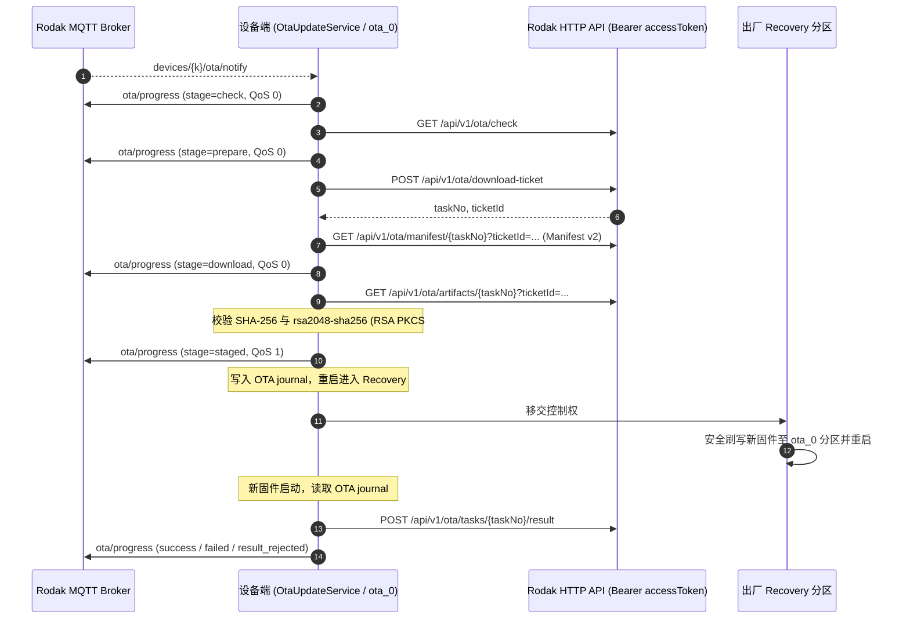

::note
**参考规范**：本文依据 [rodak-aiot-contract-v1.md](https://github.com/rymcu/rodakos/blob/main/docs/rodak-aiot-contract-v1.md)（§12–§14）与 [rymcu/rodakos](https://github.com/rymcu/rodakos) 仓库工具链整理，覆盖 OTA 全链路协同、固件签名打包、机器可读契约验证以及新人提 PR 前的自检清单。
::

::warning
**验收按产物分开**：`0.1.6` 是[当前 PROJECT_VER](https://github.com/rymcu/rodakos/blob/38f16b0d2f916106349fd93206edf16854ccae8f/CMakeLists.txt)，不是已公开发行的 OTA 包。选定候选包时记录固件源码 SHA、包内 manifest 和主应用 SHA-256，区分 PR 源提交、CI 合成合并提交和实刷二进制；主机检查或验签通过不等于完成 Recovery 刷写、启动确认和云端结果回报。[发布前主机回归入口](https://github.com/rymcu/rodakos/blob/38f16b0d2f916106349fd93206edf16854ccae8f/tools/run_release_host_checks.sh) 不替代真机。
::

## OTA 协同升级全流程（§12）

Rodak AIoT 的 OTA 机制采用 **MQTT 通知与进度上报 + HTTP 票据与包体下载 + 不可变出厂 Recovery 分区写入 `ota_0`** 的混合安全架构，由 `OtaUpdateService`、本地组件 `components/rodak_ota_state/` 与 `recovery/` 共同完成。



### 关键实现细则

1. **HTTP 鉴权与下载安全**：所有 OTA HTTP 接口均携带 `Bearer accessToken`；在 Pin 模式下，下载环节严格遵守服务端信任锚点校验，禁止重定向降级或回退到公共 CA。
2. **签名与完整性双校验**：下载 Manifest v2 与固件产物后，必须同时校验 **SHA-256 摘要**与 **RSA PKCS#1 v1.5 SHA-256 签名（`rsa2048-sha256`）**。校验失败不得进入 `staged` 阶段。
3. **QoS 级别差异**：`check`、`prepare`、`download` 阶段通过 `devices/{k}/ota/progress` 使用 **QoS 0** 上报；进入 `staged`（即将重启移交 Recovery）时，RodakOS 使用 **QoS 1** 确保服务端可靠感知。
4. **重启后闭环上报**：Recovery 将新镜像写入 `ota_0` 并重启后，新系统必须调用 `POST /api/v1/ota/tasks/{taskNo}/result`，并同步通过 MQTT `ota/progress` 上报最终状态（`success`、`failed` 或 `result_rejected`）。

### OTA 打包与签名命令

在 [rymcu/rodakos](https://github.com/rymcu/rodakos) 仓库中，使用专用脚本打包带签名的 OTA 产物（支持本地私钥签名或追加 `-OfflineSigning` 进行离线签名）：

```powershell [PowerShell]
# 激活 ESP-IDF 6.0.2 后执行
.\build_ota_bundle.ps1

# 离线签名模式
.\build_ota_bundle.ps1 -OfflineSigning
```

::caution
**再次提醒**：开发阶段刷机请使用 `.\flash_and_test.ps1 -Port COM3 -NoMonitor`（首次迁移 Recovery 分区加 `-Erase`），切勿直接运行 `idf.py flash` 或 `idf.py app-flash` 破坏出厂 Recovery 分区。
::

## 机器可读契约与自动化验证（§14）

为了防止服务端与固件端在迭代中发生“口头对齐、代码漂移”，仓库在 `contracts/rodak-aiot/v1/` 目录下维护了完整的机器可读契约资产：

| 目录 / 文件 | 用途 |
| :--- | :--- |
| `openapi.yaml` | HTTP API 端点、请求/响应信封与字段契约定义。 |
| `asyncapi.yaml` | Unified MQTT Topic、QoS 与消息载荷契约定义。 |
| `schemas/*.schema.json` | JSON Schema 2020-12 精确数据模型校验规则。 |
| `examples/valid/` | 合法报文正例夹具，必须全部通过校验。 |
| `examples/invalid/` | 非法报文反例夹具，必须全部被拦截拒绝。 |
| `ota-signing-public-key.pem` | 用于本地与 CI 验证 OTA 签名流程的测试公钥。 |

### 双向验证命令

开发者修改任何协议字段、JSON 序列化逻辑或服务端接口后，都应运行以下校验：

1. **Python 契约一致性检查**（当前覆盖 AIoT **32 个 Schema / 154 例** 与实时语音 **16 个 Schema / 70 例**，含新增的 `inbox-*`、`output-caption` 及用于校验有序数值字段的 `x-orderedFields` 扩展规则）：

```bash [契约一致性校验]
python3 tools/check_aiot_contract.py
```

2. **固件宿主契约测试与单元测试（WSL / Linux，带 ASan/UBSan 内存检查）**：契约夹具与模型测试位于 `tests/app_model/`（含 `contract_fixture_test.cc`、`inbox_model_test.cc`、`realtime_voice_contract_test.cc` 等），界面与播放链路测试位于 `tests/home_ui/`、`tests/voice_volume_service/`、`tests/display_service/` 等套件。

::code-group
```bash [单套宿主测试（tests/app_model）]
cmake -S tests/app_model -B ~/.cache/rodakos-app-model -G Ninja -DCMAKE_BUILD_TYPE=Debug
cmake --build ~/.cache/rodakos-app-model
ctest --test-dir ~/.cache/rodakos-app-model --output-on-failure
```

```bash [全量发布前回归检查（需 RODAKOS_IDF_PATH）]
export RODAKOS_IDF_PATH=/path/to/esp-idf-v6.0.2
bash tools/run_release_host_checks.sh "$HOME/.cache/rodakos-release"
```
::

## 新人开发者提 PR 前自检清单

在提交涉及 `rodak-aiot/v1` 的代码前，请逐项核对以下高发问题：

| 检查分类 | 自检项 |
| :--- | :--- |
| **身份与引导** | 是否严格区分了 `board.type`（`rymcu_bigsmart`）与 `productKey`（`rymcu-bigsmart`）？是否拒绝了不符合 `module`/`protocol`/`productKey`/`protocolVersion` 的 bootstrap 响应？ |
| **历史隔离** | 是否确认未引入任何 XiaoZhi 字段、旧 WebSocket 凭证或旧 NVS 命名空间？是否未调用废弃的 `/devices/register` 与 `/devices/activate`？ |
| **HTTP 信封** | 是否先检查 HTTP 状态码（处理 401 刷新），再检查信封 `code == 200`（防止将 HTTP 200 + 业务错误 400–503 误判为成功）？ |
| **凭证与安全** | `deviceSecret`、`requestToken`、`accessToken` 是否做到零日志输出、零 Shadow 写入？绑定成功后的凭证与配置是否采用 pending 标记原子提交？ |
| **Pin 模式边界** | Pin 模式下是否强制使用 HTTPS / `mqtts` / `wss://`？Token 刷新返回 403/404 时，Pin 模式是否只上报 `credentials rejected` 而不自动重新配对？ |
| **MQTT 与指令** | 未定义指令是否统一返回 `unsupported_command`？摄像头与屏幕 WebRTC 推流是否实现了互斥？音量是否仅通过 Shadow 控制而非 Command？ |
| **消息中心（§7.6）** | 是否仅在服务端列出 `topics.inbox_changed` 且匹配 `deviceKey` 时才订阅？`inbox/changed` 是否不带正文？动作请求是否带 `opId`/`expectedRevision` 且遵守 `read`/`complete`/`snooze` 字段互斥？记录是否仅存内存、解绑即清空、且屏幕分享时遮挡正文？ |
| **OTA 与证据** | `ota/progress` 的 `staged` 阶段是否使用了 QoS 1？下载后是否校验了 SHA-256 与 `rsa2048-sha256` 签名？音量/灯光回执是否如实标记 `physicalVerified: false`（L3）？ |
| **契约与回归** | 是否通过 `python3 tools/check_aiot_contract.py`、`contract_fixture_test.cc` 及 `tools/run_release_host_checks.sh` 全量检查？ |
