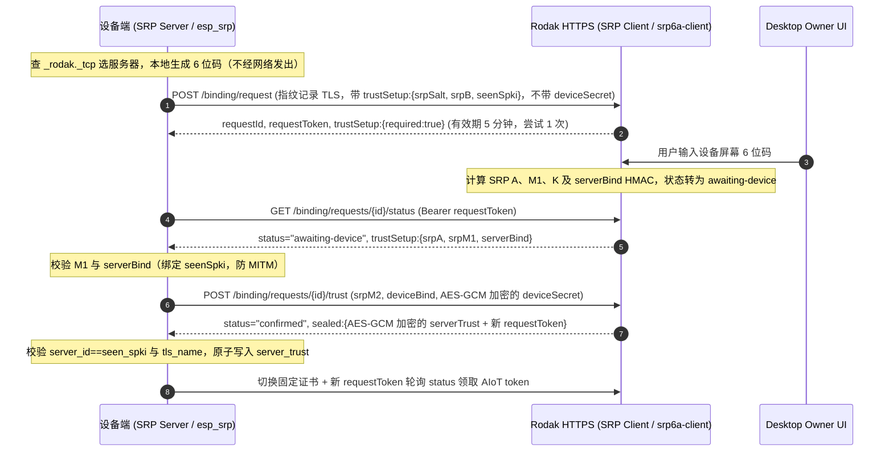

::note
**参考规范**：本文基于仓库内的 `docs/serial-provisioning.md`、`docs/qr-provisioning.md`、`docs/lan-onboarding-design.md` 与 `docs/trusted-server-discovery.md` 整理，衔接 [rodak-aiot-contract-v1.md](https://github.com/rymcu/rodakos/blob/main/docs/rodak-aiot-contract-v1.md)，帮助开发者打通设备从“出厂空白 NVS”到“建立可信服务端连接”的完整前置链路。
::

::warning
**扫码配网的证据边界**：当前二维码格式仍标为草案；固件解析、解码、持久化、扫码服务和设置页已实现，仓库记录有主机测试及固件构建，但[扫码实机验收清单](https://github.com/rymcu/rodakos/blob/38f16b0d2f916106349fd93206edf16854ccae8f/docs/qr-provisioning.md#实机验收)仍未完成。不要把串口配网或 LAN Trust 的验收结论套用到二维码路径。
::

## 三条入网路径的定位与适用场景

在设备调用 `GET /api/v1/aiot/devices/bootstrap` 之前，必须先拿到 Wi-Fi 凭据与服务端引导地址（以及可选的服务端信任锚点）。RodakOS 提供了三条定位清晰、互不冲突的入网路径：

| 入网路径 | 适用部署场景 | 是否下发信任锚点 | 核心限制与边界 |
| :--- | :--- | :--- | :--- |
| **USB 串口配网** | 本地开发、产测、局域网首次装证书 | 可选（需 `server_trust:1` 能力） | 复用 USB Serial/JTAG 控制台，单帧上限 **2048 字节**。 |
| **扫码配网（QR v1）** | 公网 HTTPS 部署（跨网段、无 mDNS） | 否（依赖内置公共 CA 包） | 拒绝 `http`、IP、`.local` 及已固定证书的设备（`WIFI:` 纯配网码除外）。 |
| **无 USB 局域网建信** | 家庭/办公同一局域网，无需数据线 | 是（通过 SRP-6a 密封下发） | 需 Rodak 开启 HTTPS；设备本地生成 **6 位码**，绝不经网络传输。 |

::caution
**共同红线**：无论走哪条配网路径，**绝不**在配网阶段直接下发 MQTT 凭据、Topic 名称或实时语音描述符；这些运行时配置统一在连网后从规范 AIoT `bootstrap` 与绑定流程中获取。
::

## USB 串口配网协议（`RODAK_PROVISION_V1`）

### 握手信标与行帧格式

串口配网直接复用 ESP-IDF 的 USB Serial/JTAG Console VFS（不额外安装 UART/USB 驱动，且配网期间**禁止**同时开启 REPL 或其他控制台读取器）。

::steps
### 等待就绪信标
服务启动后立即并每隔约 5 秒输出就绪信标：

```text [设备输出信标]
RODAK_PROVISION_READY {"version":1,"server_trust":1}
```

因为日志与配网流共用同一控制台，主机端需兼容日志前缀紧邻信标的情况。若请求携带 `server_trust`，主机端**必须**先观测到 `server_trust:1`，切勿向旧固件发送未知字段。

### 发送配网帧
发送 UTF-8 单行 JSON，支持 LF / CRLF，含前缀、载荷与换行符总长 **≤ 2048 字节**：

```text [主机发送配网帧]
RODAK_PROVISION_V1 {"ssid":"...","password":"...","bootstrap_url":"..."}\n
```

### 接收结果帧
设备不回显任何密码或密钥，仅返回结构化结果帧：

```text [设备结果回执]
RODAK_PROVISION_RESULT {"ok":true,"deviceKey":"44:1b:f6:c3:b4:30"}\n
RODAK_PROVISION_RESULT {"ok":false,"error":"invalid_bootstrap_url"}\n
```
::

### 校验规则、Nonce 绑定证明与事务流

- **字段校验**：SSID 限 1–32 字节；开放网络允许空 `password`，非空密码限 63 字节；`bootstrap_url` 仅接受 `http`/`https`、非空 authority、合法端口、无 userinfo/query/fragment，路径仅允许空、`/`、`/api/v1/aiot/devices/bootstrap` 或旧别名 `/xiaozhi/ota/`（自动规范化为规范路径）。超长帧拒收后会丢弃至下一个 LF，随后恢复正常接收。
- **自动绑定证明（可选 `binding_nonce`）**：桌面端可附带 32 字节随机数的 64 位十六进制 ASCII 字符串 `binding_nonce`。固件在不覆盖已有身份的前提下确保 `deviceSecret` 已持久化，并返回 `bindingProof`（nonce 与 proof 均不落盘，长期密钥永不经串口回传）：

```text [bindingProof 计算公式]
bindingProof = lowercaseHex(HMAC-SHA256(
  key = SHA256(UTF8(deviceSecret)),
  message = ASCII(binding_nonce)
))
```

注意：HMAC 的 `key` 是 `SHA256` 原始 32 字节摘要（而非十六进制文本），且计算时保留 `binding_nonce` 的大小写。

- **NVS 归属与事务顺序**：`wifi` 存 `ssid`/`password`，`device_cloud` 存 `prov_url`、`server_pinned`/`server_auth` 及绑定身份。写入前先完整校验，再作为单一事务保存 Wi-Fi 与引导地址、失效旧 `realtime_voice`/`unified_mqtt` 缓存，提交成功后回复结果并重连 Wi-Fi；待结果刷出 USB 后触发云端刷新（若 Unified MQTT 已在运行则重启设备以隔离旧配置边界）。

## 扫码配网协议（QR Provisioning v1）

扫码配网面向部署在公网 HTTPS（由公共 CA 签发完整证书链）的服务端，设备通过内置 `CONFIG_MBEDTLS_CERTIFICATE_BUNDLE_DEFAULT_FULL` 校验证书与域名。

### `RODAK:` 与 `WIFI:` 载荷语法

载荷采用 UTF-8 字节模式，最长 **512 字节**，以空字段 `;;` 结尾，字段顺序任意，重复字段直接判无效：

```text [RODAK QR v1 载荷格式]
RODAK:V:1;S:<SSID>;T:<认证方式>;P:<密码>;U:<服务器地址>;;
```

- **转义规则**：值中的 `\` 与 `;` 必须写成 `\\` 与 `\;`；可选转义 `,`、`:`、`"`；其他反斜杠序列或尾部孤立 `\` 均非法。`RODAK:` 中 `"` 按字面处理。
- **核心字段**：`V`（必须为 `1`）、`S`（1–32 字节无控制字符）、`T`（生成方仅写 `WPA` 或 `nopass`；拒绝 `WEP`/含 `EAP` 的值，返回 `qr_auth_unsupported`）、`P`（`WPA*`/`SAE` 需 8–63 字节或 64 位十六进制；`nopass` 为空）、`U`（服务器地址）、`H`（隐藏网络标记，v1 忽略）。
- **`U` 强校验规则**（最大 256 字节）：
  1. 必须为 `https`（`http` 返回 `qr_url_insecure`）。
  2. 主机必须为 ASCII 域名（国际化域名用 `xn--`），**禁止** IP 地址与 `.local`。
  3. 端口 1–65535 可选（`:443` 规范化时去掉）；路径仅允许空、`/` 或 `/api/v1/aiot/devices/bootstrap`。
  4. **禁止** `/xiaozhi/ota/` 与 `tenclass.net` 及其子域名（返回 `qr_url_legacy`，与串口配网不同）。
- **兼容标准 `WIFI:` 码**：如 `WIFI:T:WPA;S:HomeNet;P:s3cret-pass;;`，仅保存 Wi-Fi 不改服务器地址（即便设备已固定服务器证书也允许）。

### 设备端实现约束与服务端 Nginx 要点

- **资源与事务**：`main/phone_os/setup_qr_scan_service.cc` 使用 **12 KiB PSRAM 栈**（`quirc` 在 Xtensa 上约占 10 KiB 栈）独占音频焦点开 320×240 预览，识别后**立即停相机并释放缓冲**，再解析与确认（确认页只展示 SSID 与域名，不显示密码）。确认后的 NVS 写入必须切回**内部 RAM 栈**（PSRAM 栈不可写 NVS），并复用 `serial_prov/pending` 掉电恢复标记。
- **常见错误与结果码**：解析错误含 `qr_not_provisioning`、`qr_version_unsupported`、`qr_syntax_invalid`、`qr_ssid_invalid`、`qr_auth_unsupported`、`qr_password_invalid`、`qr_url_invalid`、`qr_url_insecure`、`qr_url_legacy`、`qr_server_pinned`；保存结果 `SetupQrApplyStatusCode` 含 `qr_wifi_saved`、`qr_server_unchanged`、`qr_server_changed`、`qr_storage_failed`、`qr_state_uncertain`。
- **公网服务端（以 Nginx 为例）**：`/api/v1/aiot/` **禁止返回 301/302 重定向**（固件关闭自动重定向）；语音 `wss://` 需配置 `Upgrade`/`Connection` 且 `proxy_read_timeout > 30s`；未固定证书时当前固件连接明文 `mqtt://`（通常 1883），公网部署建议缩短 Token 有效期并收紧 Topic 权限。

## 无 USB 局域网首次建信（LAN Trust Setup）

现有 8 位配对码由服务端经网络发给设备，在无证书信道下无法抵御中间人转发。LAN Trust Setup 通过 **mDNS 发现 + 设备本地生成 6 位码 + SRP-6a 密钥交换 + 证书指纹绑定**，在无数据线条件下获得与 USB 等价的 `server_trust`。

### 端到端交互时序



### 密码学设计与两个必避的 `esp_srp` 坑

- **SRP-6a 参数**：RFC 5054 3072 位、SHA-512，username 固定为 `rodak-trust-setup/v1`，16 字节随机 salt，口令为 6 位码去掉分隔符后的 ASCII。因 ESP-IDF `esp_srp` 仅实现服务端，故**设备做 SRP Server、Rodak 做 SRP Client**。
  - **避坑 1（前导零截断）**：`esp_srp_gen_salt_verifier` 在 salt 首字节为 0 时会丢失字节，设备必须自行生成 16 字节 salt 并计算 verifier，通过 `esp_srp_set_salt_verifier` 注入。
  - **避坑 2（`A mod N == 0` 未定义行为）**：调用 `esp_srp_get_session_key` 前必须先预检 `A` 长度为 384 字节且 `A mod N != 0`。
- **证书绑定 HMAC**：从 64 字节会话密钥 `K` 派生 `bind_key = HKDF-SHA256(K, 空, "rodak-trust-setup/v1 bind", 32)`，对 2 字节大端长度前缀拼接的 `("rodak-trust-setup/v1" || requestId || deviceKey || seen_spki || server_spki || role)` 计算 HMAC-SHA256（`role` 为 `"server"` / `"device"` 防反射）。只要中间人替换了 TLS 证书，`seen_spki != server_spki`，双方校验立即中止。
- **凭据加密与令牌轮换**：`binding/request` 带 `trustSetup` 时**严禁携带 `deviceSecret`**；`/trust` 双向使用独立 AES-256-GCM 密钥（`dev_key` info `"rodak-trust-setup/v1 device"`，`srv_key` info `"rodak-trust-setup/v1 server"`，12 字节随机 nonce，AAD 为 UTF-8 `requestId`，16 字节 tag 附于密文尾）。成功后旧 `requestToken` 立即作废，防止中间人持旧令牌领取 AIoT Token。
- **抗暴力破解**：单码仅 1 次尝试、5 分钟过期；设备校验 `M1` 失败时向 `/trust` 发送 `{"abort":"proof_mismatch"}` 立即吊销申请；连续 3 个码失败锁定入口 **60 秒**；`/trust` 重放返回 409。

## 可信服务器持久化与换网自动发现（Pin Mode）

无论是 USB 还是 LAN Trust Setup 安装的信任锚点，最终都落地为同一份 `server_trust` 结构（证书 PEM ≤ 1536 字节，固定 TLS 域名 `rodak-<server_id 前 16 位>.local`，默认安全端口 HTTPS/WSS `9443`、MQTTS `8883`）：

- **Fail-Closed 持久化**：`device_cloud/server_pinned` 先于权威记录落盘；一旦置位，若 `device_cloud/server_auth`（当前写入 **Version 3**，限 3999 字节，在根部共享 `active`/`pending` 的 trust 对象）缺失或损坏，设备**闭环失败**，绝不降级回明文 HTTP。
- **有界 mDNS 找回**：换 Wi-Fi 或笔记本 IP 变化后，已绑定设备通过常驻 PSRAM 栈的 `espressif/mdns` 1.14.0 查询 `_rodak._tcp`（超时 **1500 ms**、最多 8 条结果、严格匹配预期主机名 + 唯一 `v=1` + 完整 `id`）。最多尝试 **6 个**不同地址/端口组合，每个共享 **6 秒**超时（总上限 36 秒），拒绝 loopback、组播、`169.254/16` 与 scoped IPv6。
- **先验权、后晋升**：mDNS 记录只是未认证的路由线索。设备直连候选数字 IP 时仍强制使用已固定证书与固定 TLS 域名/SNI；只有在同一候选路由上完成 TLS `/auth/token` 鉴权**且**拿到完整安全描述符后，才晋升并持久化该 `connect_address`。纯数字路由变更可在不重启设备的情况下替换 MQTT 客户端。

## 对应源码与主机测试套件

| 模块 / 能力 | 核心固件源码（`main/phone_os/`） | 主机测试套件（`tests/`） |
| :--- | :--- | :--- |
| **USB 串口配网** | `serial_provisioning_protocol.*`、`serial_provisioning_binding.*`、`serial_provisioning_service.*` | `tests/serial_provisioning/`、`tests/app_model/serial_provisioning_frame_test.cc` |
| **扫码配网（QR）** | `setup_qr_payload.*`、`setup_qr_decoder.*`、`setup_qr_provisioning.*`、`setup_qr_scan_service.*` | `tests/setup_qr_decoder/`、`tests/app_model/setup_qr_*` |
| **LAN SRP-6a 建信** | `trust_setup_protocol.*`、`trust_setup_transport.*`、`lan_onboarding_service.*` | `tests/lan_trust_setup/`（含 `srp6a-esp-vectors.json` 与 `trust-setup-protocol-vectors.json`） |
| **可信发现与 Pin 存储** | `server_trust.*`、`server_trust_discovery.cc`、`server_trust_route.cc`、`server_trust_transport.*` | `tests/server_trust/`（29 项 ASan/UBSan 用例）、`tests/server_trust_nvs_storage/` |
