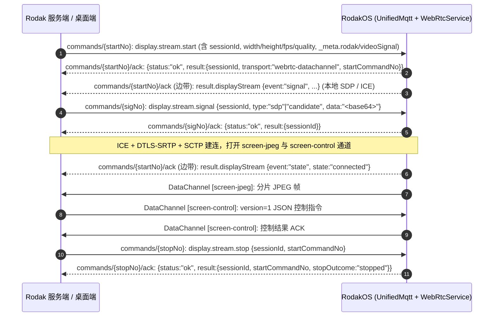

::note
**参考规范**：本文基于仓库内的 `docs/esp-peer-integration.md`、`contracts/rodak-aiot/v1/` 推流指令示例以及 `main/phone_os/webrtc_*`、`remote_input_controller.*`、`display_control_ack_tracker.h` 源码整理，帮助开发者掌握 BigSmart 的 WebRTC DataChannel 推流、远程控制协议以及 ESP32-S3 内部内存排障要点。
::

::tip
**内部内存对照基线**：排查当前版本时，从 [Main health](https://github.com/rymcu/rodakos/blob/38f16b0d2f916106349fd93206edf16854ccae8f/TROUBLESHOOTING.md#internal-sram-pressure) 同时记录 `internal_largest` 与 `dma_largest`，在[相机启动、关闭](https://github.com/rymcu/rodakos/blob/38f16b0d2f916106349fd93206edf16854ccae8f/docs/esp-peer-integration.md)及语音对话前后分别对照，不用总 PSRAM 代替 DMA 连续块。`0.1.6` 已包含常驻任务和 LVGL 的 PSRAM 调整；LCD/DVP 等 DMA 路径仍须按各自约束验收。
::

## 整体架构与 MQTT 信令协同

RodakOS 采用乐鑫 `components/esp_peer`（**v1.5.6**，搭配 ESP32-S3 预编译库 `libpeer_default.a`）作为 PeerConnection 引擎，所有音视频/画面帧均通过**有序、可靠的 WebRTC DataChannel** 传输，而 SDP 与 ICE Candidate 的交换完全复用 `rodak-aiot/v1` 的 MQTT 指令与边带回执通道：



### 信令编解码的两个高频坑

1. **Base64 缓冲区长度**：使用 Mbed TLS 进行 Base64 编码时，输出缓冲区必须至少为 `4 * ceil(n / 3) + 1` 字节（预留末尾 `\0`），否则所有非空 SDP/ICE 消息都会报 `BUFFER_TOO_SMALL`。
2. **SDP 结尾空字符**：MQTT 解码出的 SDP 原始文本不带 `\0`；传给 `esp_peer_send_msg` 前必须补 `\0`，同时保持 `message.size` 等于不含 `\0` 的纯文本长度。

## `esp_peer` 共享配置、双业务对比与必选编译项

### ESP-IDF 6.0.2 必选配置与本地补丁

ESP-IDF 6.0.2 编译 `esp_peer` DTLS-SRTP 必须开启以下配置（其中 `CONFIG_MBEDTLS_EXTERNAL_MEM_ALLOC=y` 将 DTLS 缓冲与密钥材料放入 PSRAM，避免语音唤醒与 DVP 相机 DMA 并发时 `esp_peer_open` 报 `ESP_PEER_ERR_NO_MEM (-2)`）：

```ini [sdkconfig.defaults]
CONFIG_MBEDTLS_SSL_PROTO_DTLS=y
CONFIG_MBEDTLS_SSL_DTLS_SRTP=y
CONFIG_MBEDTLS_X509_CREATE_C=y
CONFIG_MBEDTLS_EXTERNAL_MEM_ALLOC=y
```

升级 `components/esp_peer` 时必须保留本地 `src/` 的 4 处改动：① ESP-IDF 6.0+ 选用 `src/dtls_srtp_v6.c`；② PSA ECDSA 算法与证书匹配；③ `src/media_lib_weak.c` 走 PSRAM 分配；④ `dtls_srtp_v6.c` 修复 `CTR_DRBG` 互斥锁泄漏，且源码与 `libs/` 预编译库版本必须严格一致。

### Peer 共享参数（`main/phone_os/webrtc-peer-config.h`）

| 配置项 | 设定值 | 设计原因 |
| :--- | :--- | :--- |
| `max_candidates` | **32** | 预编译 S3 库中传 `0` 实际仅分配 **10** 个（而非头文件注释写的 16 个），显式设为 32 兼顾多网卡宿主。 |
| `agent_recv_timeout` | **50 ms** | 发送 JPEG 等待 SCTP 空间时保持 API 锁响应。 |
| `send_cache_size` / `recv_cache_size` | 各 **400 KiB** | 满足分片 JPEG 与控制流突发缓冲。 |
| IPv6 / TCP candidates | 关闭 | 仅走 IPv4 UDP 局域网/直连路径，降低开销。 |

### Camera 推流 vs Display 推流差异

| 对比维度 | `WebRtcCameraService` | `WebRtcDisplayService` |
| :--- | :--- | :--- |
| **DataChannel** | 单通道 `camera-jpeg` | 双通道：`screen-jpeg`（默认只读）+ `screen-control`（需显式授权） |
| **默认分辨率 / 帧率 / 分片** | `320×240`，`5 fps`，`chunk_size = 10000 B` | `320×240`（LVGL 局部刷新，仅保留最新帧），`5 fps`，`chunk_size = 20000 B`（减少 SCTP 往返） |
| **建连截止时间** | `connect_timeout_ms = 20000`（拒绝 `0`），打开 `camera-jpeg` 后清除 | 依赖流租约与 Peer 生命周期 |

::warning
**为什么 Camera 必须有 20 秒建连看门狗？**

当 DTLS 握手因 `MBEDTLS_ERR_SSL_ALLOC_FAILED` 异常重试时，`esp_peer` 主循环可能持续空转而不发出终态回调。20 秒截止时间略大于 Rodak 渲染层 15 秒首帧超时，既不误杀正常等待，又能确保超时后强制按 `CONNECT_FAILED` 释放 Peer 与相机。
::

::note
**屏幕分享首帧前的私密内容遮挡**：由于 `DisplayService` 采集包含 `lv_layer_top()` 在内的完整合成画面，无论只读共享还是开启 `screen-control`，`StartCapture` 会先置位 `capture_publishing_` 并在 LVGL 异步首帧刷新前调用 `RunBeforeFirstFrame()` 钩子，通知 `PhoneShell` 与当前应用立即隐藏全局语音字幕/进度浮层及消息中心（`MessagesApp`）正文，避免私密内容落入首帧 JPEG。
::

## 远程输入控制协议（`screen-control` DataChannel）

远程控制消息在 `screen-control` 通道上以 UTF-8 JSON 传输，要求外层携带 `"version": 1` 与 `"kind"`，并经过两层防护：

1. **序列与回执跟踪（`DisplayControlAckTracker`）**：每个 Peer 实例分配永不复用的不透明 `InstancePtr`；控制消息序号 `seq` 必须非零且严格递增；待发 ACK 队列上限 **32 条**，一旦溢出或内存分配失败即置 `overflowed_` 触发 Peer **fail-closed 终止**（绝不静默丢弃已执行结果的回执）。
2. **租约与有界队列（`RemoteInputController`）**：绑定当前 `StreamLeasePtr`，过期租约直接返回 `stale_control_lease`。待执行队列严格有界：**16 条动作**（`text`/`shortcut`）、**32 条指针事件**、**1 条延迟导航**；取消时使用固定大小 `CancelledReplies`（49 槽，零堆分配）回复 `control_disabled`。

### 四类 `kind` 消息契约

| `kind` | 关键字段与校验规则 | 行为与拒绝原因 |
| :--- | :--- | :--- |
| `control` | `action`: `"enable"` \| `"disable"` | 默认未开启控制；必须先发 `enable` 获取 `ControlGrant` 后才受理输入。`disable`、Stop 或断连会立即清空队列并取消按住手势。 |
| `pointer` | `action`: `"down"` \| `"move"` \| `"up"`，整数 `0 ≤ x < 320`、`0 ≤ y < 240` | 连续 `move` 自动合并（旧项回复 `coalesced`）；**本地触摸优先**；取消按住手势时递增 `cancel_generation` 重置 LVGL 状态，**不伪造 `up`**。 |
| `text` | `text`: 合法 UTF-8 字符串，长度 **≤ 1024 字节** | 输入到当前可见且聚焦的文本框；无目标返回 `text_target_unavailable`，非法编码返回 `invalid_utf8`。 |
| `shortcut` | `shortcut` 白名单：`back`、`home`、`enter`、`escape`、`backspace`、`delete` | `home` 与 `back` 走延迟导航路径（与 `PhoneSystem` 有界导航队列协作）；动作队列满返回 `input_queue_full`。 |

## ESP32-S3 内部 RAM 碎片化避坑（3 个真实缺陷案例）

下文 8 KiB／8,296 B 是 WebRTC 相机排障中记录的连续块现象，不是当前版本的固定剩余量，也不是 TLS 或所有场景通用的成功阈值。下面三个历史缺陷及修复仍可作为定位线索：

1. **DTLS `CTR_DRBG` 互斥锁泄漏（`components/esp_peer/src/dtls_srtp_v6.c`）**：首次自签证书路径对同一 `ctr_drbg` 连续两次调用 `mbedtls_ctr_drbg_seed`，泄漏 84 B FreeRTOS 互斥锁将 8 KiB 块劈成 6 KiB。修复：二次 seed 前先 `free` 再 `init`。
2. **DVP 首次取流延迟安装 GPIO ISR 表（`main/main.cc`）**：首次 `VIDIOC_STREAMON` 分配 392 B 永不释放的 ISR 句柄表。修复：`app_main` 在 `esp_board_manager_init` 前预先调用 `gpio_install_isr_service(ESP_INTR_FLAG_LOWMED | ESP_INTR_FLAG_IRAM)`。
3. **GDMA RX 中断向量描述符碎片（`main/main.cc`）**：首次使用新 CPU 中断线会永久分配 16 B `vector_desc_t`。修复：启动早期通过 `esp_ipc_call_blocking` 在 CPU 0（10 条）与 CPU 1（15 条）预热分配并释放全部未用中断线，将描述符锁定在低地址区。

::tip
**排障诊断命令**：使用 `RODAKOS_RELEASE_TESTS=ON` 构建的测试固件提供 5 条串口命令：`RODAK_RELEASE_TEST_V1 heap_map`、`heap_trace_start`、`heap_trace_dump`、`hold_dma <limit>`、`release_dma`（普通发布固件不含这些命令；切勿将 `CONFIG_HEAP_TRACING_STANDALONE=y` 提交进 `sdkconfig`）。
::

## 对应源码与主机测试套件

| 模块 | 核心固件源码（`main/phone_os/`） | 主机测试套件（`tests/`） |
| :--- | :--- | :--- |
| **Peer 配置与推流服务** | `webrtc-peer-config.h`、`webrtc_camera_service.*`、`webrtc_display_service.*` | `tests/display_control_ack_service/`（含负变体与任务退休测试） |
| **屏幕采集与 JPEG 分配** | `display_service.*`、`screen_jpeg_allocation.*` | `tests/display_service/`、`tests/screen_jpeg_allocator/` |
| **远程输入与 ACK 跟踪** | `remote_input_controller.*`、`display_control_ack_tracker.h` | `tests/remote_input/`、`tests/home_ui/remote_text_input_test.cc` |
